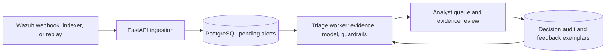

# Sentra-X

Sentra-X is a SOC alert-triage workspace for Wazuh. It builds an evidence pack, asks a configured model for a structured assessment, and applies deterministic guardrails before presenting the result to an analyst. Analysts make the final decisions. The application reads Wazuh alerts and records decisions in its own PostgreSQL database.

## How it works

The API starts the triage worker and recovers pending alerts after a restart. Gemini, Claude, and a deterministic mock adapter share the same triage pipeline. Feedback exemplars can inform later assessments. The evaluation runner compares baseline and guarded triage on synthetic inputs. Mock reports are labeled dry runs, and provider errors can make a run inconclusive.

## Start here

| Goal | Where to start |
| --- | --- |
| Explore the UI without services | [Frontend setup](frontend/README.md). Leave `VITE_API_BASE_URL` unset for the browser demo. |
| Run the API and UI locally | [Backend setup and test isolation](backend/README.md), then [frontend live mode](frontend/README.md#live-mode). |
| Run the Compose lab | Follow the [loopback Compose setup](backend/README.md#loopback-compose-lab) for the live browser API, mock inference, and a disposable database. |
| Connect Wazuh | [Wazuh sources and replay](docs/wazuh_alert_source.md). |
| Understand API and persistence | [Backend and REST reference](docs/backend_architecture_and_api_documentation.md), [database reference](docs/database_documentation.md), and the local API's `/docs` and `/openapi.json`. |

## Repository map

- `backend/` contains FastAPI, SQLAlchemy and Alembic, ingestion, the triage worker, and pytest suites. The container uses Python 3.12 and the Compose database uses PostgreSQL 16.
- `frontend/` contains the React 19, TypeScript 6 and Vite 8 SPA built with Tailwind CSS 4 and Base UI. It uses a native Fetch client for the API.
- `deploy/nginx/` and `docker-compose.yml` define the local HTTPS lab stack. `deploy/wazuh/` contains the custom Wazuh sender and Windows webhook gateway template.
- `docs/` includes current technical references and the formal [requirements](docs/sentraX_srs.md), [design](docs/sentraX_design_document.md), and [project plan](docs/sentraX_project_plan.md). Use the runtime guides for setup and the formal documents for requirements and academic history.
