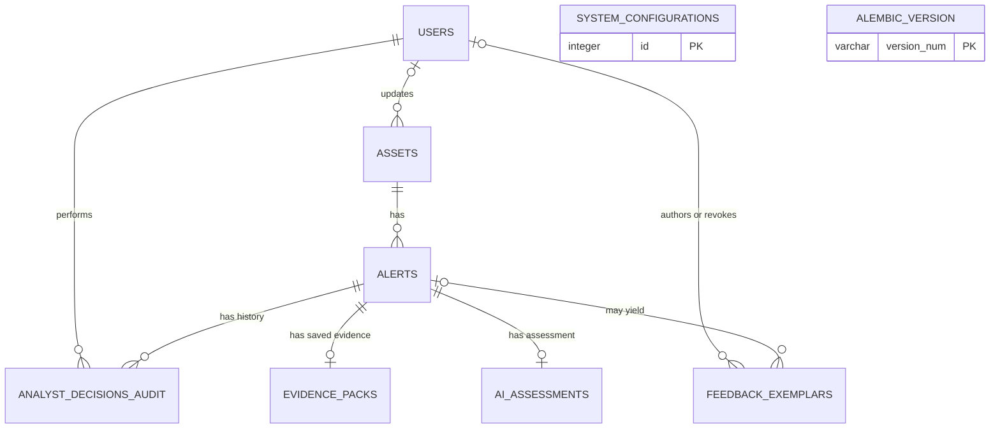

# Sentra-X PostgreSQL schema

**Eight application tables, plus one Alembic bookkeeping table.** The `public` schema has **nine tables and 98 columns** in total.

Verified on November 21, 2026 against PostgreSQL **16.16**, Alembic revision `0006_triage_generation`, in the disposable `sentrax-m04` Compose lab. This reference uses the database catalog for types, defaults, and constraints. The [Alembic migrations](../backend/alembic/versions/) define the implemented schema. The [SRS and original design](sentraX_design_document.md) provide design context. The original database reference was authored by Asad Ullah Zafar.

## Table inventory

| Table | Columns | Purpose |
| --- | ---: | --- |
| [`users`](#users) | 7 | Identity and role-based access |
| [`assets`](#assets) | 8 | Asset criticality registry |
| [`alerts`](#alerts) | 18 | Ingested Wazuh events and current status |
| [`evidence_packs`](#evidence_packs) | 8 | Saved evidence and citation targets |
| [`ai_assessments`](#ai_assessments) | 19 | AI verdicts and guardrail results |
| [`analyst_decisions_audit`](#analyst_decisions_audit) | 11 | Append-only history of human actions |
| [`feedback_exemplars`](#feedback_exemplars) | 15 | Reusable human feedback |
| [`system_configurations`](#system_configurations) | 11 | Saved admin settings |
| [`alembic_version`](#alembic_version) | 1 | Migration bookkeeping |

The schema also has two sequences, `feedback_exemplars_id_seq` and `system_configurations_id_seq`. The verified `public` schema has no views, materialized views, or partitioned tables.

## Relationships



Each evidence pack and assessment belongs to exactly one alert. A unique `alert_id` on each table limits each alert to one current row of each kind. Decisions append separate rows to the audit history. Admin settings and Alembic bookkeeping have no foreign keys.

## Column dictionary

`PK` means primary key, `FK` means foreign key, and `UQ` means unique constraint. A dash in the default column means PostgreSQL has no server default. `timestamptz` is PostgreSQL's timestamp-with-time-zone type. API-level validation may enforce additional rules.

### `users`

Identity and role-based access. 7 columns.

| Column | PostgreSQL type | Nullable | Server default | Key | Purpose |
| --- | --- | --- | --- | --- | --- |
| `id` | `uuid` | No | `gen_random_uuid()` | PK | Account identifier. |
| `username` | `varchar(64)` | No | — | UQ | Unique sign-in handle. |
| `email` | `varchar(255)` | No | — | UQ | Unique email used for sign-in. |
| `password_hash` | `varchar(255)` | No | — | — | Salted bcrypt password hash. |
| `role` | `varchar(16)` | No | — | — | Permission role. |
| `is_active` | `boolean` | No | `true` | — | Whether the account can authenticate and act. |
| `created_at` | `timestamptz` | No | `now()` | — | Account creation time. |

### `assets`

Asset criticality registry. 8 columns.

| Column | PostgreSQL type | Nullable | Server default | Key | Purpose |
| --- | --- | --- | --- | --- | --- |
| `agent_id` | `varchar(64)` | No | — | PK | Wazuh agent identifier. |
| `hostname` | `varchar(255)` | No | — | — | Current host name. |
| `ip_address` | `varchar(45)` | Yes | — | — | Recorded host IPv4 or IPv6 address, stored as text. |
| `criticality_tier` | `varchar(16)` | No | `'MEDIUM'` | — | Asset criticality used by triage and exemplar matching. |
| `description` | `text` | Yes | — | — | Operator notes on the asset. |
| `created_at` | `timestamptz` | No | `now()` | — | Registry entry creation time. |
| `updated_at` | `timestamptz` | No | `now()` | — | Most recent registry update time. |
| `updated_by` | `uuid` | Yes | — | FK | Account that last changed the asset, when known. |

### `alerts`

Ingested Wazuh events and current status. 18 columns.

| Column | PostgreSQL type | Nullable | Server default | Key | Purpose |
| --- | --- | --- | --- | --- | --- |
| `id` | `uuid` | No | `gen_random_uuid()` | PK | Internal alert identifier. |
| `wazuh_alert_id` | `varchar(128)` | No | — | UQ | Upstream event identifier used for deduplication. |
| `rule_id` | `varchar(32)` | No | — | — | Wazuh rule identifier. |
| `rule_level` | `integer` | No | — | — | Wazuh priority on the 0–15 scale. |
| `rule_description` | `text` | No | — | — | Wazuh rule description at ingestion. |
| `mitre_tactics` | `jsonb` | No | `'[]'::jsonb` | — | Persisted MITRE ATT&CK tactic names. |
| `mitre_techniques` | `jsonb` | No | `'[]'::jsonb` | — | Persisted MITRE ATT&CK technique identifiers. |
| `agent_id` | `varchar(64)` | No | — | FK | Asset associated with the event. |
| `src_ip` | `varchar(45)` | Yes | — | — | Event source IP, stored as text. |
| `process_signature` | `text` | Yes | — | — | Normalized process signature used for feedback matching. |
| `raw_payload` | `jsonb` | Yes | — | — | Original ingested Wazuh JSON. |
| `status` | `varchar(32)` | No | `'PENDING_REVIEW'` | — | Current triage state. |
| `ingested_at` | `timestamptz` | No | `now()` | — | Time the API stored the event. |
| `updated_at` | `timestamptz` | No | `now()` | — | Time of the latest alert state update. |
| `agent_name` | `varchar(255)` | No | `''` | — | Agent name snapshot at ingestion. |
| `alert_timestamp` | `timestamptz` | No | `now()` | — | Original event time, used for correlation. |
| `retry_count` | `smallint` | No | `0` | — | Automatic inference retries for the current run. A manual retry resets it. |
| `triage_generation` | `integer` | No | `0` | — | Durable AI attempt number. A human retry advances it so older workers cannot overwrite a newer attempt. |

### `evidence_packs`

Saved evidence and citation targets. 8 columns.

| Column | PostgreSQL type | Nullable | Server default | Key | Purpose |
| --- | --- | --- | --- | --- | --- |
| `id` | `uuid` | No | `gen_random_uuid()` | PK | Evidence pack identifier. |
| `alert_id` | `uuid` | No | — | FK, UQ | Alert associated with the pack. Unique. |
| `pack_json` | `jsonb` | No | — | — | Sanitized alert metadata, asset context, telemetry, and temporal context. |
| `valid_dot_keys` | `jsonb` | No | `'[]'::jsonb` | — | Saved paths into the JSON that the model can cite. |
| `injection_suspect` | `boolean` | No | `false` | — | Whether sanitization flagged suspicious content. |
| `injected_exemplar_ids` | `jsonb` | No | `'[]'::jsonb` | — | IDs used in that assessment, in selection order. Stored as JSON. |
| `created_at` | `timestamptz` | No | `now()` | — | Initial pack creation time. |
| `updated_at` | `timestamptz` | No | `now()` | — | Latest pack upsert time. |

### `ai_assessments`

AI verdicts and guardrail results. 19 columns.

| Column | PostgreSQL type | Nullable | Server default | Key | Purpose |
| --- | --- | --- | --- | --- | --- |
| `id` | `uuid` | No | `gen_random_uuid()` | PK | Assessment identifier. |
| `alert_id` | `uuid` | No | — | FK, UQ | Alert associated with the assessment. Unique. |
| `raw_verdict` | `varchar(32)` | No | — | — | Verdict returned by the model. |
| `raw_severity` | `varchar(16)` | No | — | — | Severity returned by the model. |
| `effective_verdict` | `varchar(32)` | No | — | — | Verdict after applying guardrails. |
| `effective_severity` | `varchar(16)` | No | — | — | Severity after applying guardrails. |
| `confidence_score` | `double precision` | No | — | — | Model confidence on the 0–1 scale. |
| `cited_evidence_keys` | `jsonb` | No | `'[]'::jsonb` | — | Saved dot paths into the evidence pack. |
| `explanation` | `text` | No | — | — | Saved model explanation. |
| `safety_floor_triggered` | `boolean` | No | `false` | — | Whether the severity floor changed the disposition. |
| `abstention_triggered` | `boolean` | No | `false` | — | Whether guardrails required a human verdict. |
| `guardrail_audit_note` | `text` | Yes | — | — | Explanation of guardrail intervention, when recorded. |
| `llm_provider` | `varchar(32)` | Yes | — | — | Provider associated with this assessment. |
| `model_name` | `varchar(64)` | Yes | — | — | Model identifier associated with this assessment. |
| `latency_ms` | `integer` | Yes | — | — | Legacy inference latency in milliseconds. |
| `retry_count` | `integer` | No | `0` | — | Automatic retries used by the model call. |
| `created_at` | `timestamptz` | No | `now()` | — | Initial assessment creation time. |
| `updated_at` | `timestamptz` | No | `now()` | — | Latest assessment upsert time. |
| `inference_latency_ms` | `integer` | Yes | — | — | Inference latency in milliseconds. The worker writes the same value to both latency columns. |

### `analyst_decisions_audit`

Append-only history of human actions. 11 columns.

| Column | PostgreSQL type | Nullable | Server default | Key | Purpose |
| --- | --- | --- | --- | --- | --- |
| `id` | `uuid` | No | `gen_random_uuid()` | PK | Audit-entry identifier. |
| `alert_id` | `uuid` | No | — | FK | Alert the action targeted. |
| `user_id` | `uuid` | No | — | FK | Authenticated account that performed the action. |
| `action_taken` | `varchar(32)` | No | — | — | Canonical decision action. |
| `previous_verdict` | `varchar(32)` | Yes | — | — | Effective AI verdict at decision time, when available. |
| `previous_severity` | `varchar(16)` | Yes | — | — | Effective AI severity at decision time, when available. |
| `final_verdict` | `varchar(32)` | Yes | — | — | Authoritative human disposition. Null for escalation and retry. |
| `final_severity` | `varchar(16)` | Yes | — | — | Authoritative human severity. Null for escalation and retry. |
| `rationale` | `text` | No | `''` | — | Reason supplied for the decision. |
| `exemplar_created` | `boolean` | No | `false` | — | Whether the same transaction created a feedback exemplar. |
| `created_at` | `timestamptz` | No | `now()` | — | Decision timestamp used for reporting. |

### `feedback_exemplars`

Reusable human feedback. 15 columns.

| Column | PostgreSQL type | Nullable | Server default | Key | Purpose |
| --- | --- | --- | --- | --- | --- |
| `id` | `integer` | No | `nextval('feedback_exemplars_id_seq'::regclass)` | PK | Sequence-generated exemplar identifier. |
| `source_alert_id` | `uuid` | Yes | — | FK | Originating alert, when retained. |
| `rule_id` | `varchar(32)` | No | — | — | Wazuh rule used in later matching. |
| `process_signature` | `text` | Yes | — | — | Signature for exact-process matching, when available. |
| `asset_criticality` | `varchar(16)` | No | — | — | Tier snapshot used for fallback matching. |
| `calibrated_verdict` | `varchar(32)` | No | — | — | Human-confirmed binary verdict. |
| `calibrated_severity` | `varchar(16)` | No | — | — | Human-confirmed severity. |
| `rationale` | `text` | No | — | — | Justification provided to future triage when selected. |
| `is_active` | `boolean` | No | `true` | — | Whether the exemplar is eligible for future selection. |
| `match_hit_count` | `integer` | No | `0` | — | Number of recorded selections. |
| `created_by` | `uuid` | Yes | — | FK | Legacy author field synchronized with `user_id`. |
| `created_at` | `timestamptz` | No | `now()` | — | Exemplar creation time, used to rank recent matches. |
| `revoked_by` | `uuid` | Yes | — | FK | Account that most recently revoked the exemplar. |
| `revoked_at` | `timestamptz` | Yes | — | — | Revocation time, cleared upon reactivation. |
| `user_id` | `uuid` | Yes | — | FK | Canonical exemplar author. |

### `system_configurations`

Saved admin settings. 11 columns.

| Column | PostgreSQL type | Nullable | Server default | Key | Purpose |
| --- | --- | --- | --- | --- | --- |
| `id` | `integer` | No | `nextval('system_configurations_id_seq'::regclass)` | PK | Sequence-generated settings record identifier. Migrations seed one row and the admin endpoints read the first row. |
| `wazuh_endpoint` | `varchar(255)` | No | `'https://wazuh-master.sentrax.internal:55000'` | — | Saved admin Wazuh endpoint value. |
| `wazuh_status` | `varchar(32)` | No | `'CONNECTED'` | — | Saved Wazuh status label. |
| `polling_interval_seconds` | `integer` | No | `30` | — | Saved poll interval in seconds. |
| `min_rule_level` | `integer` | No | `4` | — | Saved minimum level to display in settings. |
| `llm_provider` | `varchar(32)` | No | `'Gemini'` | — | Saved provider selection. |
| `model_name` | `varchar(64)` | No | `'gemini-3.1-flash-lite'` | — | Saved model name. |
| `abstention_threshold` | `double precision` | No | `0.6` | — | Saved confidence threshold. |
| `max_exemplars_injected` | `integer` | No | `2` | — | Saved exemplar limit. |
| `last_sync_timestamp` | `timestamptz` | No | `now()` | — | Saved last-sync timestamp. |
| `updated_at` | `timestamptz` | No | `now()` | — | Settings record update time. |

### `alembic_version`

Migration bookkeeping. 1 columns.

| Column | PostgreSQL type | Nullable | Server default | Key | Purpose |
| --- | --- | --- | --- | --- | --- |
| `version_num` | `varchar(32)` | No | — | PK | Current Alembic migration head. |

## Foreign keys and deletion rules

| Referencing column | Referenced key | On delete |
| --- | --- | --- |
| `assets.updated_by` | `users.id` | Set null |
| `alerts.agent_id` | `assets.agent_id` | Restrict |
| `evidence_packs.alert_id` | `alerts.id` | Cascade |
| `ai_assessments.alert_id` | `alerts.id` | Cascade |
| `analyst_decisions_audit.alert_id` | `alerts.id` | Restrict |
| `analyst_decisions_audit.user_id` | `users.id` | Restrict |
| `feedback_exemplars.source_alert_id` | `alerts.id` | Set null |
| `feedback_exemplars.created_by` | `users.id` | Set null |
| `feedback_exemplars.user_id` | `users.id` | Set null |
| `feedback_exemplars.revoked_by` | `users.id` | Set null |

PostgreSQL prevents ordinary deletion of an asset while an alert references it. An audit entry also prevents ordinary deletion of its alert and actor. When an unreferenced alert can be deleted, PostgreSQL deletes its current evidence and assessment and clears any exemplar's source reference. Historical `injected_exemplar_ids` are JSON values. The API resolves these saved IDs to feedback records and can display a revoked example.

## Check constraints

| Table | Constraint | Database rule |
| --- | --- | --- |
| `users` | `ck_users_role` | `Analyst`, `TeamLead`, or `Admin` |
| `assets` | `ck_assets_criticality_tier` | `LOW`, `MEDIUM`, `HIGH`, or `CRITICAL` |
| `alerts` | `ck_alerts_rule_level` | 0–15 inclusive |
| `alerts` | `ck_alerts_retry_count` | At least 0 |
| `alerts` | `ck_alerts_status` | `PENDING_REVIEW`, `AWAITING_ANALYST`, `NEEDS_MANUAL_TRIAGE`, `ESCALATED`, or `CLOSED` |
| `ai_assessments` | `ck_ai_assessments_raw_verdict` | `TRUE_POSITIVE`, `FALSE_POSITIVE`, or `NEEDS_ANALYST_REVIEW` |
| `ai_assessments` | `ck_ai_assessments_raw_severity` | `LOW`, `MEDIUM`, `HIGH`, or `CRITICAL` |
| `ai_assessments` | `ck_ai_assessments_confidence_score` | 0–1 inclusive |
| `ai_assessments` | `ck_ai_assessments_retry_count` | 0–3 inclusive |
| `analyst_decisions_audit` | `ck_audit_action_taken` | `APPROVE`, `OVERRIDE`, `ESCALATE`, `RETRY_AI`, `MANUAL_TRIAGE_CLOSURE`, or `RESOLVE_ESCALATION` |
| `feedback_exemplars` | `ck_exemplars_asset_criticality` | `LOW`, `MEDIUM`, `HIGH`, or `CRITICAL` |
| `feedback_exemplars` | `ck_exemplars_calibrated_verdict` | `TRUE_POSITIVE` or `FALSE_POSITIVE` |
| `feedback_exemplars` | `ck_exemplars_rationale_length` | At least 10 characters |

The [decision endpoint](backend_architecture_and_api_documentation.md#queue-and-decisions) enforces the action-to-state matrix, role permissions, and final-disposition rules. The worker validates effective verdicts and severities. The settings singleton and the attempt-number increment are application conventions.

## Indexes

All 22 catalog indexes use B-tree. The primary-key and unique-constraint indexes are included.

| Table | Index | Kind | Columns and predicate |
| --- | --- | --- | --- |
| `ai_assessments` | `ai_assessments_pkey` | Unique | `(id)` |
| `ai_assessments` | `ix_ai_assessments_alert_id` | Non-unique | `(alert_id)` |
| `ai_assessments` | `uq_ai_assessments_alert_id` | Unique | `(alert_id)` |
| `alembic_version` | `alembic_version_pkc` | Unique | `(version_num)` |
| `alerts` | `alerts_pkey` | Unique | `(id)` |
| `alerts` | `ix_alerts_agent_timestamp` | Non-unique | `(agent_id, alert_timestamp DESC)` |
| `alerts` | `ix_alerts_queue_priority` | Non-unique | `(status, ingested_at)` |
| `alerts` | `ix_alerts_src_ip_timestamp` | Non-unique | `(src_ip, alert_timestamp DESC) WHERE (src_ip IS NOT NULL)` |
| `alerts` | `uq_alerts_wazuh_alert_id` | Unique | `(wazuh_alert_id)` |
| `analyst_decisions_audit` | `analyst_decisions_audit_pkey` | Unique | `(id)` |
| `analyst_decisions_audit` | `ix_audit_alert_id` | Non-unique | `(alert_id)` |
| `analyst_decisions_audit` | `ix_audit_user_id` | Non-unique | `(user_id)` |
| `assets` | `assets_pkey` | Unique | `(agent_id)` |
| `evidence_packs` | `evidence_packs_pkey` | Unique | `(id)` |
| `evidence_packs` | `ix_evidence_packs_alert_id` | Non-unique | `(alert_id)` |
| `evidence_packs` | `uq_evidence_packs_alert_id` | Unique | `(alert_id)` |
| `feedback_exemplars` | `feedback_exemplars_pkey` | Unique | `(id)` |
| `feedback_exemplars` | `ix_exemplars_retrieval` | Non-unique | `(rule_id, asset_criticality, created_at DESC) WHERE (is_active = true)` |
| `system_configurations` | `system_configurations_pkey` | Unique | `(id)` |
| `users` | `uq_users_email` | Unique | `(email)` |
| `users` | `uq_users_username` | Unique | `(username)` |
| `users` | `users_pkey` | Unique | `(id)` |

The partial active-exemplar index covers rule, tier, and recency. Exact-signature and fallback matching are implemented in the [exemplar service](../backend/app/exemplars/service.py). The queue index covers status and ingestion time. The two correlation indexes support host/time and source-IP/time queries.

## Triggers

| Table | Trigger | Function | When and effect |
| --- | --- | --- | --- |
| `analyst_decisions_audit` | `trg_audit_immutability` | `prevent_audit_modification()` | Before row update or delete. Raises an exception to preserve ordinary append-only audit history. |
| `feedback_exemplars` | `trg_sync_feedback_exemplar_user` | `sync_feedback_exemplar_user()` | Before row insert or update. Copies the non-null author field to the other field. When both are present, `user_id` takes precedence. |

The audit trigger handles row updates and deletes. Database ownership and privileges govern operations such as truncation and trigger administration. Timestamp defaults run on insert. Subsequent application updates set `updated_at` where required.

## How the data is written

1. **Ingestion.** The service registers an unseen asset and deduplicates the event on `wazuh_alert_id`. It commits the alert before enqueueing it. Unusable rule levels can enter manual triage directly.
2. **AI triage.** The worker reads the asset tier, matching exemplars, and attempt number. It releases the database connection during inference. It later locks the alert and persists the result only if the same attempt is still pending. This writes evidence, assessment, and status together.
3. **Human decisions.** The API locks the alert, validates the action, and commits the status change, audit row, and any new exemplar in one transaction. A human retry advances `triage_generation`, resets retry counts, and enqueues after commit. The worker sweep recovers committed pending work after restart.
4. **Reporting.** Analytics and CSV read audit rows. The previous and final verdicts on each decision capture what was known at that moment. Evidence packs retain the IDs of the examples used in the saved assessment.
5. **Admin settings.** The prototype stores admin display settings in `system_configurations`. The running worker, provider, and ingestion settings come from their environment configuration.

The backend uses Psycopg 3. `DATABASE_URL` selects the synchronous SQLAlchemy driver for migrations, routes, ingestion, and triage. `DATABASE_URL_ASYNC` selects the async session factory. See the [backend setup](../backend/README.md).

## Migration history

| Revision | Schema change |
| --- | --- |
| [`0001_initial_schema`](../backend/alembic/versions/0001_initial_schema.py) | Creates the seven initial application tables, indexes, and audit trigger. |
| [`0002_align_srs_v14`](../backend/alembic/versions/0002_align_srs_v14.py) | Adds alert timestamps and retries, inference latency, and attribution fields. Extends the audit action check. |
| [`0003_add_srs_check_constraints`](../backend/alembic/versions/0003_add_srs_check_constraints.py) | Adds validation checks, the default asset tier, and the canonical exemplar author. |
| [`0004_add_system_configurations`](../backend/alembic/versions/0004_add_system_configurations.py) | Creates and seeds the admin settings table. |
| [`0005_abr_audit_hardening`](../backend/alembic/versions/0005_abr_audit_hardening.py) | Aligns correlation and queue indexes, normalizes manual-closure actions, permits missing asset IP and process signature, and adds the exemplar-author trigger. |
| [`0006_triage_generation`](../backend/alembic/versions/0006_triage_generation.py) | Adds the durable retry attempt number and initializes existing rows to zero. |

## Inspect your checkout

Open `psql` against the intended lab database. The [Compose setup](../backend/README.md#loopback-compose-lab) shows how to connect to the default `sentrax` database.

```sql
SELECT version_num FROM public.alembic_version;

SELECT table_name, count(*) AS columns
FROM information_schema.columns
WHERE table_schema = 'public'
GROUP BY table_name
ORDER BY table_name;
```

Inside `psql`, `\dt public.*` lists tables and `\d+ public.alerts` shows a table's columns, indexes, and constraints. The [schema test](../backend/tests/test_db_schema.py) also exercises the audit trigger. Run mutating tests and maintenance scripts only against an explicitly [disposable test database](../backend/README.md#testing-and-maintenance).


