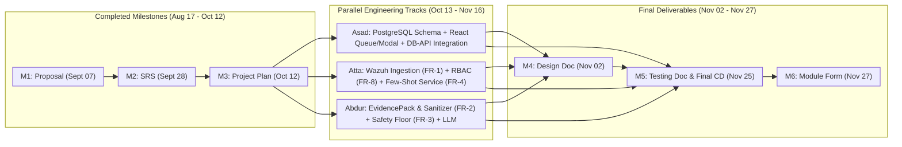

<style>
@media print, screen {
  h1, h2, h3, h4,
  h1 + h2, h2 + h3, h3 + h4,
  h2 + p, h3 + p, h4 + p {
    page-break-after: avoid !important;
    break-after: avoid-page !important;
  }
  pre, .mermaid, svg, table, figure, blockquote, tr {
    page-break-inside: avoid !important;
    break-inside: avoid !important;
  }
  .mermaid {
    text-align: center;
    margin: 6px auto 12px auto !important;
    page-break-before: avoid !important;
    break-before: avoid-page !important;
  }
  .mermaid svg {
    max-width: 98% !important;
    max-height: 280px !important;
    height: auto !important;
    width: auto !important;
    display: block;
    margin: 0 auto !important;
  }
}
</style>

# Software Project Management & Implementation Plan (SPMP)

## Sentra-X: An Evidence-Grounded and Uncertainty-Aware Human-in-the-Loop SOC Alert Triage Copilot

| Document Attribute | Details |
| :--- | :--- |
| **Document Version** | 1.1 |
| **Release Date** | October 12, 2026 (Official Deliverable #3 Deadline) |
| **Academic Term** | Fall Semester 2026 (Teaching: 17 August 2026 – 27 November 2026; Final Exams: 30 November 2026) |
| **Institution** | Department of Computer and Information Systems Engineering, NED University of Engineering & Technology |
| **Authors / Project Team** | Asad Ullah Zafar (CS-24082), Atta Ur Rehman (CS-24092), Abdur Rehman (CS-24098) |
| **Submitted To / Supervisors** | Mr. Muhammad Ali Akhtar — Practical Class Teacher (DDL Lab, Mr. Khurram Alvi) & Dr. Fakhra Aftab — Theory Class Teacher |
| **Companion Specification** | Sentra-X Software Requirements Specification (SRS v1.3) |

---

## Table of Contents

1. [Project Overview](#1-project-overview)
   * [1.1 Purpose of the Project Plan](#11-purpose-of-the-project-plan)
   * [1.2 Project Scope & Core Novelty Pillars](#12-project-scope--core-novelty-pillars)
   * [1.3 Strict Out-of-Scope Boundaries](#13-strict-out-of-scope-boundaries)
   * [1.4 Official Fall Semester 2026 Deliverables & Deadlines](#14-official-fall-semester-2026-deliverables--deadlines)
2. [Process Model & Engineering Methodology](#2-process-model--engineering-methodology)
   * [2.1 Selected SDLC Model: Iterative & Incremental Agile-Scrum](#21-selected-sdlc-model-iterative--incremental-agile-scrum)
   * [2.2 Rationale for Methodology Selection](#22-rationale-for-methodology-selection)
   * [2.3 Sprint & Supervisor Review Cadence](#23-sprint--supervisor-review-cadence)
3. [Project Organization & Team Responsibilities](#3-project-organization--team-responsibilities)
   * [3.1 Team Structure & Module Ownership](#31-team-structure--module-ownership)
   * [3.2 Module Distribution Matrix (Core Features & Subsystem Split)](#32-module-distribution-matrix-core-features--subsystem-split)
   * [3.3 Responsibility Assignment Matrix (RACI)](#33-responsibility-assignment-matrix-raci)
4. [Work Breakdown Structure (WBS) & Technical Work Packages](#4-work-breakdown-structure-wbs--technical-work-packages)
   * [4.1 WBS Architecture Diagram](#41-wbs-architecture-diagram)
   * [4.2 Detailed Work Packages (`WP-1` to `WP-6`)](#42-detailed-work-packages-wp-1-to-wp-6)
   * [4.3 Repository & Module Implementation Blueprint](#43-repository--module-implementation-blueprint)
5. [Project Schedule, Sprints & Milestones (15-Week Fall Semester)](#5-project-schedule-sprints--milestones-15-week-fall-semester)
   * [5.1 Fall Semester 2026 Master Schedule (Weeks 1–15: Aug 17 – Nov 27, 2026)](#51-fall-semester-2026-master-schedule-weeks-115-aug-17--nov-27-2026)
   * [5.2 Critical Path & Parallel Execution Diagram](#52-critical-path--parallel-execution-diagram)
   * [5.3 Milestone Gate Criteria (`M1` to `M6`)](#53-milestone-gate-criteria-m1-to-m6)
6. [Resource, Effort & Cost Estimation](#6-resource-effort--cost-estimation)
   * [6.1 Hardware & Software Resource Requirements](#61-hardware--software-resource-requirements)
   * [6.2 Engineering Effort Estimation (Person-Hours Across 15 Weeks)](#62-engineering-effort-estimation-person-hours-across-15-weeks)
   * [6.3 LLM API Quota & Operational Budget Control](#63-llm-api-quota--operational-budget-control)
7. [Risk Management Plan](#7-risk-management-plan)
   * [7.1 Risk Assessment Methodology](#71-risk-assessment-methodology)
   * [7.2 Technical, Operational & Schedule Risk Register](#72-technical-operational--schedule-risk-register)
8. [Quality Assurance, Verification & Evaluation Plan](#8-quality-assurance-verification--evaluation-plan)
   * [8.1 Multi-Layer Testing Strategy (For Nov 25 Testing Document)](#81-multi-layer-testing-strategy-for-nov-25-testing-document)
   * [8.2 Non-Functional Target Verification Matrix](#82-non-functional-target-verification-matrix)
   * [8.3 Research & Adversarial Evaluation Protocol (`FR-10`)](#83-research--adversarial-evaluation-protocol-fr-10)
9. [Configuration, Change & Delivery Management](#9-configuration-change--delivery-management)
   * [9.1 Version Control & Branching Strategy](#91-version-control--branching-strategy)
   * [9.2 Documentation & Persistent Context Protocol](#92-documentation--persistent-context-protocol)
   * [9.3 Final CD Submission & Module Distribution Handover Checklist (Nov 25–27)](#93-final-cd-submission--module-distribution-handover-checklist-nov-2527)
10. [Appendix: Document Revision History](#10-appendix-document-revision-history)

---

## 1. Project Overview

### 1.1 Purpose of the Project Plan
This Software Project Management & Implementation Plan (SPMP) defines the execution roadmap, work breakdown structure (WBS), team member module distribution, 15-week Fall Semester schedule, resource estimates, risk mitigations, and verification protocols for **Sentra-X**. It translates the functional (`FR-1`–`FR-10`), non-functional (`NFR-1`–`NFR-6`), and relational data requirements specified in the **Sentra-X Software Requirements Specification (SRS v1.3)** into an actionable engineering plan aligned with the official **Fall Semester 2026 Project Deliverables & Deadlines (17 August 2026 – 27 November 2026)**.

### 1.2 Project Scope & Core Novelty Pillars
Security Operations Centers (SOCs) face severe alert fatigue from high-volume SIEM platforms such as **Wazuh**, while naive LLM triage tools suffer from hallucinated threat attributions, overconfident binary verdicts on incomplete telemetry, silent downgrades of critical alerts, and vulnerability to indirect prompt injection.

Sentra-X is a containerized, human-in-the-loop decision-support copilot built with **React 19 (TypeScript + Vite + Tailwind CSS + shadcn/ui)**, **PostgreSQL 16**, **Python 3.11+ (FastAPI + SQLAlchemy 2.0)**, and a swappable **Google Gemini / Anthropic Claude** LLM adapter. Every engineering milestone reinforces Sentra-X's **five core novelty pillars**:

1. **Pillar 1 — Explicit Evidence Grounding (`FR-2`):** Compiles a structured `EvidencePack` combining raw Wazuh telemetry, MITRE ATT&CK metadata, host criticality tier (`FR-9`), and up to `K = 5` temporally correlated alerts (`24h` window). Requires the LLM to return **dot-notation JSON key paths** (`cited_evidence_keys`) that are deterministically verified against the `EvidencePack`.
2. **Pillar 2 — Uncertainty-Aware Abstention (`FR-3`):** Refuses to force binary `TRUE_POSITIVE` / `FALSE_POSITIVE` classifications when evidence is weak (`confidence_score < 0.60`), citations are empty/invalid, outputs are self-contradictory, or prompt injection is suspected alongside a benign recommendation—deterministically routing the alert to `NEEDS_ANALYST_REVIEW`.
3. **Pillar 3 — Deterministic Multi-Tier Safety Floor (`FR-3`):** Enforces a hard backend policy blocking AI false-positive dismissals or severity downgrades on Critical (`rule.level ≥ 12`) and High (`rule.level 10–11`) Wazuh detections.
4. **Pillar 4 — Dynamic Few-Shot Feedback Calibration (`FR-4`):** Stores verified human override rationales (`≥ 10 characters`) in PostgreSQL and dynamically injects the top `2` matching active exemplars in `< 50ms` using two-tier signature matching (`rule_id + process_signature`, then `rule_id + asset_criticality`), with Team Lead exemplar revocation (`is_active = false`).
5. **Pillar 5 — Adversarial Prompt-Injection Defense (`FR-2`, `NFR-3`):** Sanitizes control characters and delimiter spoofing tokens (`PromptSanitizer`), flags `injection_suspect`, and isolates untrusted telemetry inside read-only JSON envelopes to achieve a **`0%` bypass rate** across a 30-payload adversarial benchmark.

### 1.3 Strict Out-of-Scope Boundaries
To guarantee full working completion before the **25th November 2026** final submission deadline, the following items are strictly out of scope:
* **No Autonomous Active Response:** Sentra-X is a read-only decision-support system; it never modifies Wazuh rules, kills processes, blocks IPs, or alters firewall policies.
* **No LLM Weight Fine-Tuning or GNNs:** Adaptation relies strictly on in-context few-shot exemplar retrieval (`FR-4`); parameter fine-tuning (LoRA/SFT), multi-agent architectures, and Graph Neural Networks are excluded.
* **No Orphaned Alert States:** Every alert transitions strictly within the closed-loop 5-state machine (`PENDING_REVIEW`, `AWAITING_ANALYST`, `NEEDS_MANUAL_TRIAGE`, `ESCALATED`, `CLOSED`).

### 1.4 Official Fall Semester 2026 Deliverables & Deadlines
Per the official course schedule (**Teaching: 17 August 2026 – 27 November 2026 | Final Examinations Begin: 30 November 2026**), all project deliverables are submitted to **Mr. Muhammad Ali Akhtar (DDL Lab, Mr. Khurram Alvi)**:

| S.No | Official Deliverable | Official Deadline | Submitted To | Current Status |
| :---: | :--- | :--- | :--- | :--- |
| **1** | **Project Proposal** | **07th September, 2026 (Monday)** | Mr. Muhammad Ali Akhtar (DDL Lab Mr. Khurram Alvi) | **Completed** (`Sentra-X_Proposal_Updated.pdf`) |
| **2** | **Software Requirement Specification (SRS)** | **28th September, 2026 (Monday)** | Mr. Muhammad Ali Akhtar (DDL Lab Mr. Khurram Alvi) | **Completed** (`sentraX_srs.md` / `SentraX_SRS_Final.pdf`) |
| **3** | **Project Plan** | **12th October, 2026 (Monday)** | Mr. Muhammad Ali Akhtar (DDL Lab Mr. Khurram Alvi) | **Completed** (`sentraX_project_plan.md`) |
| **4** | **Design Document** | **02nd November, 2026 (Monday)** | Mr. Muhammad Ali Akhtar (DDL Lab Mr. Khurram Alvi) | In Progress / Scheduled (Weeks 7–11) |
| **5** | **Testing Document & Final Project (in CD)** | **25th November, 2026 (Wednesday)** | Mr. Muhammad Ali Akhtar (DDL Lab Mr. Khurram Alvi) | Scheduled (Weeks 12–15) |
| **6** | **Module Distribution Form, Core Features, Working & Non-Working Functionalities Details** | **27th November, 2026 (Friday)** | Mr. Muhammad Ali Akhtar (DDL Lab Mr. Khurram Alvi) | Scheduled (Week 15 Final Handover) |

---

## 2. Process Model & Engineering Methodology

### 2.1 Selected SDLC Model: Iterative & Incremental Agile-Scrum
Sentra-X follows an **Iterative and Incremental Agile-Scrum** lifecycle aligned directly with the 15-week Fall Semester teaching window (`17 August 2026 – 27 November 2026`). Following the completion of the Proposal (`Sept 07`), SRS (`Sept 28`), and Project Plan (`Oct 12`), the remaining 6.5 weeks are structured into three focused engineering sprints mapped to the **Design Document (`Nov 02`)**, **Testing Document & Final Project CD (`Nov 25`)**, and **Module Distribution & Functionality Audit (`Nov 27`)**.

```mermaid
%%{init: {'flowchart': {'nodeSpacing': 14, 'rankSpacing': 22, 'padding': 6}, 'themeVariables': {'fontSize': '11px'}}}%%
flowchart LR
    D1["1. Proposal (Sept 07)"] --> D2["2. SRS (Sept 28)"]
    D2 --> D3["3. Project Plan (Oct 12)"]
    D3 --> D4["4. Design Doc & Core Build (Nov 02)"]
    D4 --> D5["5. Testing Doc & Final CD (Nov 25)"]
    D5 --> D6["6. Module Distribution Form (Nov 27)"]
    D5 -.->|"Feedback Calibration"| D4
```



### 2.2 Rationale for Methodology Selection
1. **Database-First Contract Alignment:** By having **Asad Ullah Zafar** establish the PostgreSQL schema, SQLAlchemy ORM layer, and frontend-backend API integration contracts early, the React dashboard and backend Wazuh/LLM pipelines can be built concurrently without integration bottlenecks.
2. **Parallel Wazuh & Backend Execution:** While Asad builds the Analyst Queue, Evidence Trace Modal, Decision Capture UI, and DB integration, **Atta Ur Rehman** and **Abdur Rehman** develop the Wazuh SIEM ingestion service, Evidence Pack compiler, Prompt Sanitizer, LLM adapters, and Deterministic Safety Floor in parallel.
3. **Deadline Alignment:** Each sprint produces both working software and the exact formal artifact required by **Mr. Muhammad Ali Akhtar** on `Nov 02`, `Nov 25`, and `Nov 27`.

### 2.3 Sprint & Supervisor Review Cadence
* **Bi-Weekly Practical Lab Checkpoints:** Conducted in **DDL Lab** with **Mr. Muhammad Ali Akhtar** and **Mr. Khurram Alvi**, paired with theory alignment reviews under **Dr. Fakhra Aftab**.
* **Definition of Done (DoD):** A module is marked complete only when: (a) database persistence and API integration are verified end-to-end, (b) RBAC (`FR-8`) and deterministic safety rules (`FR-3`) pass unit/integration tests, and (c) [gemini.md](file:///c:/projects/SentraX/docs/gemini.md) is updated.

---

## 3. Project Organization & Team Responsibilities

### 3.1 Team Structure & Module Ownership
Work is distributed across the three team members according to subsystem specialization—separating **Frontend UX + Full-Stack Database Integration** from **Wazuh SIEM Telemetry + Backend AI/Guardrail Services**:

| Team Member | Roll No. | Primary Role | Core Engineering Ownership |
| :--- | :--- | :--- | :--- |
| **Asad Ullah Zafar** | `CS-24082` | **Frontend, Database & Full-Stack Integration Lead** | **Frontend SPA & UI/UX:** React 19 + TypeScript + Tailwind/shadcn dashboard, Penpot wireframes, Prioritized Analyst Review Queue & Split-Pane Evidence Trace Modal (`FR-5`), Decision Capture UI (`Approve`, `Override`, `Escalate`, `Retry AI`, `Resolve` — `FR-6`), Team Lead Agreement Analytics & CSV Export UI (`FR-7`), Login & Role Guards (`FR-8`), and Asset/Exemplar Governance UI (`FR-4`, `FR-9`).<br>**Database & Integration:** PostgreSQL 16 schema (all 7 tables), SQLAlchemy 2.0 ORM models, composite/partial indexes (`< 50ms` lookup), `analyst_decisions_audit` immutability trigger, and end-to-end Frontend ↔ FastAPI ↔ Database integration. |
| **Atta Ur Rehman** | `CS-24092` | **Wazuh SIEM & Core Backend Infrastructure Lead** | **Wazuh Integration & Ingestion (`FR-1`, `FR-9`):** Wazuh v4.x environment setup & alert replay generator, `IngestionService` (REST poller every `30s` + webhook listener), informational noise filter (`rule.level < 4`), `wazuh_alert_id` deduplication, `process_signature` extraction, and Backend Host/Asset Criticality service (`FR-9`).<br>**Backend Security & Calibration Services (`FR-4`, `FR-8`):** Salted `bcrypt` (`cost ≥ 10`) & JWT RBAC middleware (`FR-8`), Backend `FeedbackCalibrationService` (two-tier exemplar retrieval & revocation logic — `FR-4`), and Docker Compose orchestration. |
| **Abdur Rehman** | `CS-24098` | **Backend AI Triage, Guardrails & Evaluation Lead** | **Wazuh Telemetry Enrichment & Sanitization (`FR-2`, `NFR-3`):** `EvidenceAssembler` (Wazuh telemetry parsing, MITRE ATT&CK mapping, `24h` host/IP temporal correlation, and dot-notation key extraction) and `PromptSanitizer` (control/delimiter stripping, `injection_suspect` detection, read-only JSON envelope).<br>**LLM Adapters, Safety Floor & Benchmarking (`FR-2`, `FR-3`, `FR-7`, `FR-10`):** Swappable `GeminiAdapter` / `ClaudeAdapter` (`10s` timeout + 3x retry backoff), Deterministic `RulesEngine` (Abstention & Multi-Tier Safety Floor — `FR-3`), Backend Analytics SQL aggregation (`FR-7`), and 30-Payload Adversarial & Baseline Evaluation Runner (`FR-10`). |

### 3.2 Module Distribution Matrix (Core Features & Subsystem Split)
This matrix serves as the baseline specification for **Deliverable #6 (`Module Distribution Form`, due 27th November 2026)**:

| Subsystem / Module | Mapped FRs / NFRs | Primary Owner | Secondary / Integration Partner | Target Completion |
| :--- | :--- | :--- | :--- | :--- |
| **1. PostgreSQL 16 Schema, ORM Models, Indexes & Audit Immutability Trigger** | `Section 7`, `NFR-4` | **Asad Ullah Zafar (`CS-24082`)** | Atta Ur Rehman (`CS-24092`) | Oct 24, 2026 |
| **2. Frontend ↔ Backend ↔ Database REST Contract & State Integration** | `FR-5`, `FR-6`, `FR-7`, `FR-8`, `FR-9` | **Asad Ullah Zafar (`CS-24082`)** | Atta Ur Rehman & Abdur Rehman | Nov 18, 2026 |
| **3. Prioritized Analyst Review Queue & Split-Pane Evidence Trace Modal (React SPA)** | `FR-5`, `Usability NFR` | **Asad Ullah Zafar (`CS-24082`)** | Abdur Rehman (`CS-24098`) | Nov 14, 2026 |
| **4. Analyst & Team Lead Decision Capture UI, Login Screen & Analytics Dashboard** | `FR-6`, `FR-7`, `FR-8` UI | **Asad Ullah Zafar (`CS-24082`)** | Atta Ur Rehman (`CS-24092`) | Nov 18, 2026 |
| **5. Wazuh SIEM Setup, Poller/Webhook Ingestion, Noise Filter & Deduplication** | `FR-1`, `NFR-2`, `NFR-5` | **Atta Ur Rehman (`CS-24092`)** | Abdur Rehman (`CS-24098`) | Oct 28, 2026 |
| **6. Backend JWT Auth / RBAC Middleware, Asset Criticality Service & Docker Compose** | `FR-8`, `FR-9`, `NFR-3`, `NFR-6` | **Atta Ur Rehman (`CS-24092`)** | Asad Ullah Zafar (`CS-24082`) | Nov 02, 2026 |
| **7. Backend Dynamic Few-Shot Feedback Calibration Service (Tiered Retrieval)** | `FR-4`, `NFR-4` | **Atta Ur Rehman (`CS-24092`)** | Asad Ullah Zafar (`CS-24082`) | Nov 10, 2026 |
| **8. Evidence Pack Compiler, Prompt-Injection Sanitizer & Gemini/Claude Adapters** | `FR-2`, `NFR-1`, `NFR-3`, `NFR-6` | **Abdur Rehman (`CS-24098`)** | Atta Ur Rehman (`CS-24092`) | Nov 06, 2026 |
| **9. Deterministic Abstention & Multi-Tier Safety Floor Rules Engine** | `FR-3`, `NFR-1` | **Abdur Rehman (`CS-24098`)** | Atta Ur Rehman (`CS-24092`) | Nov 10, 2026 |
| **10. Backend Analytics Aggregation Queries & 30-Payload Evaluation Runner** | `FR-7` API, `FR-10`, `NFR-3` | **Abdur Rehman (`CS-24098`)** | Asad Ullah Zafar & Atta Ur Rehman | Nov 22, 2026 |

### 3.3 Responsibility Assignment Matrix (RACI)
*Legend: **R** = Responsible (Implements), **A** = Accountable (Approves/Owns Quality), **C** = Consulted, **I** = Informed.*

| Work Package / Official Deliverable | Asad (`CS-24082`)<br>*(Frontend & DB Integration)* | Atta (`CS-24092`)<br>*(Wazuh & Backend Core)* | Abdur (`CS-24098`)<br>*(Backend AI & Guardrails)* | Supervisors |
| :--- | :---: | :---: | :---: | :---: |
| **`WP-1`:** Proposal, SRS & Project Plan (`S.No 1–3`) | **R / A** | **R** | **R** | **A / I** |
| **`WP-2`:** PostgreSQL Schema, ORM & DB Integration Layer | **R / A** | **C** | **C** | **I** |
| **`WP-3`:** Wazuh Ingestion (`FR-1`), Auth/RBAC (`FR-8`), Assets (`FR-9`) & Calibration (`FR-4`) | **C** *(DB/API Wiring)* | **R / A** | **R** | **I** |
| **`WP-4`:** Evidence Pack, Sanitizer (`FR-2`), LLM Adapters & Safety Floor (`FR-3`) | **I** | **R** | **R / A** | **I** |
| **`WP-5`:** React SPA Queue (`FR-5`), Decisions (`FR-6`), Analytics (`FR-7`) & End-to-End Integration | **R / A** | **C** | **C** | **I** |
| **`WP-6`:** Design Doc (`S.No 4`), Testing Doc & CD (`S.No 5`), Benchmark (`FR-10`) & Module Form (`S.No 6`) | **R / A** | **R** | **R** | **A** |

---

## 4. Work Breakdown Structure (WBS) & Technical Work Packages

### 4.1 WBS Architecture Diagram

```mermaid
%%{init: {'flowchart': {'nodeSpacing': 12, 'rankSpacing': 22, 'padding': 6}, 'themeVariables': {'fontSize': '11px'}}}%%
flowchart TB
    ROOT["Sentra-X Project (WBS 1.0)"] --> WP1["1.1 Specs & Plans (Completed: Sept 07 - Oct 12)"]
    ROOT --> WP2["1.2 PostgreSQL Schema & DB Integration (Asad)"]
    ROOT --> WP3["1.3 Wazuh SIEM & Core Backend (Atta)"]
    ROOT --> WP4["1.4 AI Triage & Safety Rules Engine (Abdur)"]
    ROOT --> WP5["1.5 React SPA Queue, Decisions & Analytics (Asad)"]
    ROOT --> WP6["1.6 Design Doc, Testing, CD & Module Form (All)"]

    WP2 --> T21["7 Tables, Indexes & Audit Trigger"] & T22["SQLAlchemy ORM & API Schemas"]
    WP3 --> T31["Wazuh Poller & Noise Filter (FR-1)"] & T32["JWT RBAC & Assets (FR-8, FR-9)"] & T33["Tiered Few-Shot Service (FR-4)"]
    WP4 --> T41["EvidencePack & Sanitizer (FR-2)"] & T42["Gemini/Claude Adapters (FR-2)"] & T43["Safety Floor & Abstention (FR-3)"]
    WP5 --> T51["Analyst Queue & Evidence Modal (FR-5)"] & T52["Decision Bar & Audit Wiring (FR-6)"] & T53["Analytics & CSV UI (FR-7)"]
    WP6 --> T61["Design Doc (Nov 02)"] & T62["FR-10 Eval & Testing Doc + CD (Nov 25)"] & T63["Module Distribution Form (Nov 27)"]
```



### 4.2 Detailed Work Packages (`WP-1` to `WP-6`)

#### `WP-1`: Proposal, SRS & Project Plan *(Completed: Weeks 1–8 | Aug 17 – Oct 12, 2026)*
* **Owners:** Asad Ullah Zafar, Atta Ur Rehman, Abdur Rehman
* **Completed Tasks:**
  * `1.1.1` Literature review (`sentra_novelty_research.pdf`) & Deliverable #1 (**Project Proposal**, submitted `07 Sept 2026`).
  * `1.1.2` Deliverable #2 (**Software Requirement Specification**, submitted `28 Sept 2026`, refined to v1.3 with 10 sections, System Models, ER Schema, and RTM).
  * `1.1.3` Frontend React 19 + TypeScript + Vite + Tailwind CSS + shadcn/ui project initialization (`frontend/`).
  * `1.1.4` Deliverable #3 (**Project Plan / SPMP**, completed `12 Oct 2026`).

#### `WP-2`: Database Architecture, ORM Layer & Full-Stack Data Contracts *(Weeks 8–10 | Oct 13 – Oct 26, 2026)*
* **Lead Owner:** **Asad Ullah Zafar (`CS-24082`)**
* **Mapped Requirements:** `SRS Section 7`, `FR-4` Index, `FR-5` Index, `FR-6` Audit Trigger, `NFR-4`
* **Tasks:**
  * `1.2.1` **PostgreSQL 16 Schema & Migrations:** Implement the 7 core tables (`users`, `assets`, `alerts`, `evidence_packs`, `ai_assessments`, `analyst_decisions_audit`, `feedback_exemplars`) via SQLAlchemy 2.0 and Alembic.
  * `1.2.2` **High-Speed Indexing & Audit Immutability:** Create the unique index on `alerts(wazuh_alert_id)`, 24h correlation index on `alerts(agent_id, src_ip, alert_timestamp DESC)`, queue index on `alerts(status, rule_level DESC, ingested_at ASC)`, `< 50ms` partial composite index on `feedback_exemplars`, and the PostgreSQL `BEFORE UPDATE OR DELETE` trigger on `analyst_decisions_audit`.
  * `1.2.3` **Frontend-Backend-Database API Contracts:** Define shared Pydantic v2 response models and TypeScript interfaces (`AlertQueueItem`, `EvidencePackDTO`, `AIAssessmentDTO`, `DecisionRequestDTO`, `AnalyticsSummaryDTO`) so the React frontend and FastAPI routers integrate seamlessly with PostgreSQL.

#### `WP-3`: Wazuh SIEM Integration, Core Backend Infrastructure & Feedback Calibration *(Weeks 9–12 | Oct 19 – Nov 10, 2026)*
* **Lead Owner:** **Atta Ur Rehman (`CS-24092`)** *(with Abdur Rehman on Wazuh log parsing & Asad on DB wiring)*
* **Mapped Requirements:** `FR-1`, `FR-4`, `FR-8`, `FR-9`, `NFR-2`, `NFR-3`, `NFR-4`, `NFR-5`
* **Tasks:**
  * `1.3.1` **Wazuh v4.x Connector & Alert Replay Generator (`FR-1`):** Configure Wazuh REST API polling (`every N = 30s`) and `/api/v1/ingest/webhook` endpoint, plus a synthetic Wazuh alert replay script for high-throughput (`5 alerts/sec`) and offline testing.
  * `1.3.2` **Noise Filtering & Deduplication (`FR-1`):** Drop informational events (`rule.level < 4`), deduplicate by `wazuh_alert_id`, extract normalized `process_signature`, and persist `PENDING_REVIEW` alerts.
  * `1.3.3` **JWT Authentication & RBAC Middleware (`FR-8`):** Implement salted `bcrypt` (`cost ≥ 10`) password verification, JWT generation, and FastAPI role guards (`Analyst`, `TeamLead`, `Admin`) returning HTTP `401` / `403`.
  * `1.3.4` **Host Criticality Service (`FR-9`) & Tiered Few-Shot Calibration (`FR-4`):** Auto-register new Wazuh `agent.id` entries as `MEDIUM` criticality, implement `< 50ms` two-tier exemplar lookup (`Tier 1: rule_id + process_signature`; `Tier 2: rule_id + asset_criticality`), and expose Team Lead exemplar revocation endpoints.

#### `WP-4`: Guarded AI Triage Pipeline, Prompt Sanitizer & Deterministic Safety Floor *(Weeks 9–12 | Oct 19 – Nov 10, 2026)*
* **Lead Owner:** **Abdur Rehman (`CS-24098`)** *(with Atta Ur Rehman on backend worker orchestration)*
* **Mapped Requirements:** `FR-2`, `FR-3`, `FR-7` (Backend SQL), `NFR-1`, `NFR-3`, `NFR-6`
* **Tasks:**
  * `1.4.1` **Evidence Pack Compiler (`FR-2`):** Build `EvidenceAssembler` to combine raw Wazuh alert fields, MITRE ATT&CK IDs/tactics, host `criticality_tier`, and up to `K = 5` correlated alerts (`24h` window) into a structured `EvidencePack` with precomputed `valid_dot_keys`.
  * `1.4.2` **Prompt-Injection Sanitizer (`FR-2`, `NFR-3`):** Build `PromptSanitizer` to strip control bytes and delimiter-spoofing strings (`</system>`, `[INST]`, code fences), flag adversarial override strings with `injection_suspect = true`, and isolate telemetry inside a read-only JSON envelope.
  * `1.4.3` **Swappable Gemini & Claude Adapters (`FR-2`, `NFR-6`):** Implement `GeminiAdapter` (`google-genai`) and `ClaudeAdapter` (`anthropic`) behind an environment-configured factory with strict JSON schema validation, `10s` timeout, and 3x exponential backoff (`1s`, `2s`, `4s`) transitioning failed alerts to `NEEDS_MANUAL_TRIAGE`.
  * `1.4.4` **Deterministic Abstention & Multi-Tier Safety Floor Engine (`FR-3`):**
    * Force `effective_verdict = NEEDS_ANALYST_REVIEW` when `confidence_score < 0.60`, `cited_evidence_keys` is empty/unverified against `valid_dot_keys`, verdict/severity is contradictory, or `injection_suspect = true` with a benign recommendation.
    * Enforce Critical Safety Floor (`rule_level ≥ 12` blocks `FALSE_POSITIVE` or `< HIGH` severity) and High Safety Floor (`rule_level 10–11` blocks `FALSE_POSITIVE` or `LOW` severity).

#### `WP-5`: Frontend React SPA — Analyst Queue, Evidence Modal, Decision Capture & Analytics Integration *(Weeks 10–14 | Oct 26 – Nov 18, 2026)*
* **Lead Owner:** **Asad Ullah Zafar (`CS-24082`)**
* **Mapped Requirements:** `FR-5`, `FR-6`, `FR-7`, `FR-8` UI, `FR-9` UI, `Usability NFR`
* **Tasks:**
  * `1.5.1` **Login View & Role-Protected Routing (`FR-8`):** Build `/login` with JWT storage, Axios auth interceptors, and role-aware navigation for `Analyst`, `TeamLead`, and `Admin` users.
  * `1.5.2` **Prioritized Analyst Review Queue (`FR-5`):** Build `/queue` with tabs for `Awaiting Review` (`AWAITING_ANALYST` + `NEEDS_MANUAL_TRIAGE`), `Escalated` (`ESCALATED`), and `Closed` (`CLOSED`), sorted by effective severity (`CRITICAL` → `LOW`) and `ingested_at ASC`, with severity/rule/search filters connected live to PostgreSQL via FastAPI.
  * `1.5.3` **Split-Pane Alert Detail & Evidence Trace Modal (`FR-5`):** Render the structured `EvidencePack` tree with visual highlights on every dot-notation key in `cited_evidence_keys`, MITRE ATT&CK badges, raw Wazuh JSON log viewer, Safety Floor / Abstention warning banners, and injected few-shot exemplars.
  * `1.5.4` **Decision Capture & Database Audit Integration (`FR-6`):** Connect `Approve` (`≤ 2 clicks`), `Override` (`≥ 10 char` mandatory rationale with inline HTTP `422` error banner, triggering `FR-4` exemplar creation), `Escalate`, `Retry AI`, `Manual Close`, and Team Lead `Resolve Escalation` directly to atomic PostgreSQL transactions in `alerts`, `analyst_decisions_audit`, and `feedback_exemplars`.
  * `1.5.5` **Team Lead Agreement Analytics, CSV Export & Governance Views (`FR-7`, `FR-4`, `FR-9`):** Build `/analytics` charts (`% Approved`, `% Overridden`, Safety Floor/Abstention counts, daily Override Rate Trendline), one-click streaming CSV download, Exemplar Revocation table (`is_active` toggle), and Host Criticality Registry UI.

#### `WP-6`: Design Document, Adversarial Benchmark (`FR-10`), Testing Document, Final CD & Module Form *(Weeks 11–15 | Nov 02 – Nov 27, 2026)*
* **Owners:** All Three Members (Coordinated Submission Deliverables #4, #5, and #6)
* **Tasks:**
  * `1.6.1` **Deliverable #4 — Design Document (`Due: 02 Nov 2026`):** Compile architectural design, UML/Mermaid sequence & class diagrams, database schema DDL, API specifications, and UI wireframes.
  * `1.6.2` **Adversarial & Baseline Evaluation Runner (`FR-10`):** Execute the 30-payload prompt-injection benchmark (`0%` bypass target) and compare `BASELINE_RAW_LLM` vs. `SENTRAX_FULL` (Abdur Rehman & Atta Ur Rehman, integrated with DB/UI by Asad Ullah Zafar).
  * `1.6.3` **Deliverable #5 — Testing Document & Final Project CD (`Due: 25 Nov 2026`):** Execute unit, integration, RBAC, immutability, and `5 alerts/sec` load tests; package complete source code, Docker Compose setup, database seeders, and Testing Document onto CD.
  * `1.6.4` **Deliverable #6 — Module Distribution Form & Functionality Report (`Due: 27 Nov 2026`):** Submit signed module ownership breakdown, core features checklist, and working vs. non-working functionality declaration.

### 4.3 Repository & Module Implementation Blueprint

```text
c:\projects\SentraX\
├── docker-compose.yml                  # [Atta & Asad] Orchestrates postgres:16, backend, and frontend
├── .env.example                        # Environment template (WAZUH_*, LLM_PROVIDER, JWT_SECRET, DB_URL)
├── docs/                               # Project documentation & deliverables
│   ├── 2026 Project deadlines.pdf      # Official Fall 2026 Deliverables & Deadlines
│   ├── Sentra-X_Proposal_Updated.pdf   # Deliverable #1 (Submitted Sept 07, 2026)
│   ├── sentraX_srs.md                  # Deliverable #2 (Submitted Sept 28, 2026; updated v1.3)
│   ├── sentraX_project_plan.md         # Deliverable #3 (Submitted Oct 12, 2026)
│   └── gemini.md                       # Persistent Engineering Context Memory
├── backend/                            # [Atta & Abdur; DB Models/Integration by Asad]
│   ├── Dockerfile
│   ├── requirements.txt
│   ├── alembic/                        # [Asad] PostgreSQL 16 migrations + audit immutability trigger
│   ├── app/
│   │   ├── main.py                     # [Atta] FastAPI app, CORS, lifespan Wazuh poller
│   │   ├── database.py                 # [Asad] SQLAlchemy 2.0 session & PostgreSQL connection pool
│   │   ├── models/                     # [Asad] 7 ORM models (users, assets, alerts, packs, assessments, audit, exemplars)
│   │   ├── schemas/                    # [Asad] Shared Pydantic v2 DTOs matching Frontend TypeScript types
│   │   ├── services/
│   │   │   ├── ingestion_service.py    # [Atta] FR-1: Wazuh poller/webhook, noise filter (level >= 4), dedup
│   │   │   ├── auth_service.py         # [Atta] FR-8: Bcrypt (cost >= 10), JWT & RBAC guards
│   │   │   ├── calibration_service.py  # [Atta] FR-4: Sub-50ms tiered exemplar retrieval & revocation
│   │   │   ├── evidence_assembler.py   # [Abdur] FR-2: Wazuh log parser, MITRE, 24h correlation & valid_dot_keys
│   │   │   ├── prompt_sanitizer.py     # [Abdur] FR-2 / NFR-3: Delimiter stripping & injection_suspect scanner
│   │   │   ├── llm_adapter.py          # [Abdur] FR-2 / NFR-6: Gemini & Claude adapters + 3x retry backoff
│   │   │   ├── rules_engine.py         # [Abdur] FR-3: Deterministic Abstention & Multi-Tier Safety Floor
│   │   │   └── evaluation_runner.py    # [Abdur] FR-10: BASELINE_RAW_LLM vs. SENTRAX_FULL & 30-payload runner
│   │   └── routers/                    # [Asad & Atta] REST API endpoints binding Frontend to DB & Services
│   └── tests/                          # [All] Unit, safety floor boundary, DB immutability & injection tests
└── frontend/                           # [Asad] React 19 + TypeScript + Vite + Tailwind CSS + shadcn/ui
    ├── Dockerfile
    ├── src/
    │   ├── api/                        # [Asad] REST API client, JWT interceptor & DB state hooks
    │   ├── context/                    # [Asad] AuthContext & RBAC route protection
    │   ├── views/
    │   │   ├── LoginView.tsx           # [Asad] FR-8: JWT login screen
    │   │   ├── TriageQueueView.tsx     # [Asad] FR-5: Prioritized Analyst Queue, tabs & filters
    │   │   ├── TeamLeadAnalyticsView.tsx # [Asad] FR-7: Agreement charts, override trendlines & CSV export
    │   │   └── GovernanceView.tsx      # [Asad] FR-4 & FR-9: Exemplar revocation & Asset Criticality UI
    │   └── components/
    │       ├── AlertDetailModal.tsx    # [Asad] FR-5: Split-pane EvidencePack inspector & cited-key highlights
    │       └── DecisionActionPanel.tsx # [Asad] FR-6: Approve, Override, Escalate, Retry AI & Resolve actions
```

---

## 5. Project Schedule, Sprints & Milestones (15-Week Fall Semester)

### 5.1 Fall Semester 2026 Master Schedule (Weeks 1–15: Aug 17 – Nov 27, 2026)

| Weeks & Dates | Phase / Sprint | Key Activities & Deliverables | Primary Owner(s) |
| :--- | :--- | :--- | :--- |
| **Weeks 1–3** (`17 Aug – 07 Sept 2026`) | **Phase 1: Proposal & Novelty** | Problem formulation, literature comparison (`sentra_novelty_research.pdf`), 5-pillar architecture, **Deliverable #1: Project Proposal (`07 Sept`)**. | All (`Completed`) |
| **Weeks 4–6** (`08 Sept – 28 Sept 2026`) | **Phase 2: Requirements (SRS)** | Elicitation of `FR-1`–`FR-10` & `NFR-1`–`NFR-6`, System Models, 7-table ER schema, **Deliverable #2: SRS (`28 Sept`)** & React scaffold. | All (`Completed`) |
| **Weeks 7–8** (`29 Sept – 12 Oct 2026`) | **Phase 3: SRS v1.3 & Project Plan** | Refinement of SRS to v1.3 (`SentraX_SRS_Final.pdf`), WBS & team role allocation, **Deliverable #3: Project Plan (`12 Oct`)**. | All (`Completed`) |
| **Weeks 9–11** (`13 Oct – 02 Nov 2026`) | **Sprint 1: DB Layer, Wazuh Ingestion, AI Engine & Design Doc** | • **Asad:** PostgreSQL 16 schema, 7 ORM models, indexes, audit immutability trigger, API DTOs, UI wireframes & Queue/Login views.<br>• **Atta:** Wazuh poller/webhook (`FR-1`), JWT RBAC (`FR-8`), Asset service (`FR-9`).<br>• **Abdur:** `EvidenceAssembler`, `PromptSanitizer` (`FR-2`), `RulesEngine` (`FR-3`).<br>• **Deliverable #4: Design Document (`02 Nov`)**. | Asad (`DB & UI`),<br>Atta (`Wazuh & Auth`),<br>Abdur (`AI & Rules`) |
| **Weeks 12–13** (`03 Nov – 16 Nov 2026`) | **Sprint 2: Full-Stack Integration, Decision Workflows & Calibration** | • **Asad:** Full-stack integration of Prioritized Analyst Queue, Cited-Key Evidence Modal (`FR-5`), Decision Capture (`FR-6`), and Team Lead Analytics/Governance UI (`FR-7`) with PostgreSQL & FastAPI.<br>• **Atta:** Tiered Few-Shot Calibration service (`FR-4`) & Docker Compose wiring.<br>• **Abdur:** Gemini/Claude live integration, retry fallback (`NEEDS_MANUAL_TRIAGE`), and analytics SQL queries. | Asad (`Frontend-DB-Backend Integration`),<br>Atta & Abdur (`Backend`) |
| **Weeks 14–15** (`17 Nov – 27 Nov 2026`) | **Sprint 3: Evaluation (`FR-10`), Testing Doc, CD & Module Form** | • **All:** End-to-end testing, `FR-10` 30-payload adversarial benchmark & `BASELINE_RAW_LLM` vs. `SENTRAX_FULL` evaluation.<br>• **Deliverable #5: Testing Document & Final Project in CD (`25 Nov`)**.<br>• **Deliverable #6: Module Distribution Form & Core Features Details (`27 Nov`)**. | All Members |

### 5.2 Critical Path & Parallel Execution Diagram



### 5.3 Milestone Gate Criteria (`M1` to `M6`)

| Milestone | Official Deadline | Verification Gate / Acceptance Criteria |
| :--- | :--- | :--- |
| **`M1`: Project Proposal** | **07 Sept 2026 (Mon)** | Proposal approved by Mr. Muhammad Ali Akhtar and Dr. Fakhra Aftab (`Completed`). |
| **`M2`: SRS Submission** | **28 Sept 2026 (Mon)** | Complete SRS specifying `FR-1`–`FR-10`, `NFR-1`–`NFR-6`, System Models, and 7-table ER schema (`Completed`). |
| **`M3`: Project Plan** | **12 Oct 2026 (Mon)** | SPMP v1.1 baselined with Fall 2026 deadlines and finalized 3-member module distribution (`Completed`). |
| **`M4`: Design Document & Core Backend/DB Gate** | **02 Nov 2026 (Mon)** | Design Document submitted; PostgreSQL 7-table schema & ORM live (Asad); Wazuh ingestion & RBAC working (Atta); Evidence Pack & Safety Floor unit-tested (Abdur). |
| **`M5`: Testing Document & Final Project (in CD)** | **25 Nov 2026 (Wed)** | Full React SPA integrated with Backend & PostgreSQL (Asad); live Gemini/Claude triage & `FR-10` 30-payload injection benchmark (`0%` bypass) verified; Testing Document & CD submitted. |
| **`M6`: Module Distribution Form & Final Audit** | **27 Nov 2026 (Fri)** | Module Distribution Form detailing each member's core features and 100% working functionality verification submitted prior to Final Exams (`30 Nov`). |

---

## 6. Resource, Effort & Cost Estimation

### 6.1 Hardware & Software Resource Requirements

| Resource Category | Specification | Owner / Usage | Cost |
| :--- | :--- | :--- | :--- |
| **Development Workstations** | 3x Laptops (`≥ 4 vCPUs`, `8–16 GB RAM`, SSD, Docker Desktop) | Used by Asad (Frontend/DB), Atta (Wazuh/Backend), and Abdur (AI/Rules). | `$0` (Existing) |
| **SIEM / Telemetry Source** | Wazuh v4.x + Synthetic Wazuh Alert Replay Generator | Atta & Abdur — generates realistic and adversarial alerts for `FR-1` & `FR-10`. | `$0` (Open Source) |
| **Database & Backend Stack** | PostgreSQL 16, SQLAlchemy 2.0, Python 3.11+, FastAPI, Pydantic v2 | Asad (Schema/ORM/Integration), Atta & Abdur (Services & Guardrails). | `$0` (Open Source) |
| **Frontend & UI Stack** | React 19, TypeScript, Vite, Tailwind CSS, shadcn/ui, Penpot | Asad — Analyst Queue, Evidence Modal, Decision Capture & Analytics UI. | `$0` (Open Source) |
| **Hosted LLM APIs** | Google Gemini API (`google-genai`) & Anthropic Claude API (`anthropic`) | Abdur — Schema-constrained grounded triage inference (`FR-2`, `FR-10`). | Free Tier / Credits |

### 6.2 Engineering Effort Estimation (Person-Hours Across 15 Weeks)
Across the 15-week semester (`17 Aug – 27 Nov 2026`), assuming **12 hours/week per member** (`3 members × 12 hrs/wk × 15 wks = 540 total person-hours`):

| Work Package | Asad (`CS-24082`)<br>*(Frontend & DB Integration)* | Atta (`CS-24092`)<br>*(Wazuh & Backend Core)* | Abdur (`CS-24098`)<br>*(Backend AI & Guardrails)* | Total Hours | % Effort |
| :--- | :---: | :---: | :---: | :---: | :---: |
| **`WP-1`:** Proposal, SRS & Project Plan (`S.No 1–3`) | 35 hrs | 35 hrs | 35 hrs | **105 hrs** | 19.4% |
| **`WP-2`:** PostgreSQL 16 Schema, ORM, Indexes & API Contracts | 45 hrs | 10 hrs | 10 hrs | **65 hrs** | 12.0% |
| **`WP-3`:** Wazuh Ingestion (`FR-1`), Auth/RBAC (`FR-8`), Assets (`FR-9`) & Calibration (`FR-4`) | 10 hrs | 80 hrs | 15 hrs | **105 hrs** | 19.4% |
| **`WP-4`:** Evidence Pack, Sanitizer (`FR-2`), LLM Adapters & Safety Floor (`FR-3`) | 10 hrs | 20 hrs | 80 hrs | **110 hrs** | 20.4% |
| **`WP-5`:** React SPA Queue (`FR-5`), Decisions (`FR-6`), Analytics (`FR-7`) & DB Integration | 60 hrs | 10 hrs | 10 hrs | **80 hrs** | 14.8% |
| **`WP-6`:** Design Doc (`S.No 4`), Benchmark (`FR-10`), Testing Doc + CD (`S.No 5`) & Module Form (`S.No 6`) | 20 hrs | 25 hrs | 30 hrs | **75 hrs** | 13.9% |
| **Total Estimated Effort** | **180 hrs** | **180 hrs** | **180 hrs** | **540 hrs** | **100.0%** |

### 6.3 LLM API Quota & Operational Budget Control
1. **Mandatory Pre-Filtering (`FR-1`):** Events with `rule.level < 4` are ignored before LLM invocation, cutting unnecessary API calls by `60%–80%`.
2. **Idempotent Deduplication:** Duplicate `wazuh_alert_id` payloads are skipped at ingestion.
3. **Mock LLM Mode for Frontend & Load Testing:** Asad's frontend-to-database integration tests and Atta's `5 alerts/sec` ingestion stress tests can toggle `LLM_PROVIDER=mock` to test queue rendering and database transactions at zero API cost, reserving live Gemini/Claude calls for end-to-end verification and Abdur's `FR-10` benchmark runs.

---

## 7. Risk Management Plan

### 7.1 Risk Assessment Methodology
Risks are rated by **Probability** (`Low`, `Medium`, `High`) and **Impact** (`Low`, `Medium`, `High`, `Critical`), with concrete technical and schedule mitigations assigned to the responsible owner.

### 7.2 Technical, Operational & Schedule Risk Register

| Risk ID | Risk Description | Owner | Prob. | Impact | Mitigation & Contingency Strategy |
| :--- | :--- | :--- | :---: | :---: | :--- |
| **`R-1`** | **LLM Hallucinates Citations or Downgrades Critical Alerts:** LLM cites non-existent keys or marks a `level ≥ 10` attack as `FALSE_POSITIVE`. | Abdur (`CS-24098`) | Med | Critical | **Mitigated by `FR-3`:** `RulesEngine` verifies every key in `cited_evidence_keys` against `valid_dot_keys` and enforces the Multi-Tier Safety Floor, forcing `NEEDS_ANALYST_REVIEW`. |
| **`R-2`** | **Indirect Prompt Injection in Wazuh Logs:** Malicious strings in `full_log` or `commandLine` attempt to force `FALSE_POSITIVE`. | Abdur (`CS-24098`) | High | Critical | **Mitigated by `FR-2` & `FR-3`:** `PromptSanitizer` strips delimiters, sets `injection_suspect = true`, isolates telemetry in read-only JSON, and `FR-3` blocks benign verdicts when flagged. |
| **`R-3`** | **Frontend-Backend-Database Integration Bottleneck Late in Semester:** UI views wait on backend services to be completed. | Asad (`CS-24082`) | Med | High | **Mitigated by DB-First & Seed Data:** Asad builds the PostgreSQL schema, ORM models, and seeded test alerts first (Week 9), enabling full React queue/modal/decision integration against real DB rows while Wazuh/LLM services are wired in parallel. |
| **`R-4`** | **Full Wazuh VM Resource Contention on Local Machines:** Running full Wazuh Indexer/Dashboard consumes 8+ GB RAM. | Atta (`CS-24092`) | Med | Med | **Mitigated by Replay Service:** Atta provides a lightweight Wazuh Alert Replay utility that streams authentic Wazuh v4.x JSON alerts into `FR-1` without requiring the heavy OpenSearch indexer during daily coding. |
| **`R-5`** | **Hosted LLM API Rate Limits or Timeouts (`> 10s`):** Cloud API throttling stalls live demos or testing. | Abdur & Atta | Med | High | **Mitigated by `FR-2` & `NFR-6`:** 3x exponential backoff (`1s`, `2s`, `4s`) with deterministic fallback to `NEEDS_MANUAL_TRIAGE` (with UI `Retry AI` button) and config-only switch between Gemini and Claude. |
| **`R-6`** | **Tight Compression Between Design Doc (`Nov 02`) and Final CD (`Nov 25`):** Only 23 days separate Deliverables #4 and #5. | All Members | Med | High | **Mitigated by Parallel Sprints:** Core database, ingestion, and rules engine code is completed alongside the Design Document by `Nov 02`, leaving `Nov 03–Nov 25` focused on full-stack integration, UI polish, and testing. |

---

## 8. Quality Assurance, Verification & Evaluation Plan

### 8.1 Multi-Layer Testing Strategy (For Nov 25 Testing Document)

1. **Database & Integration Tests (Led by Asad Ullah Zafar):**
   * Verify foreign-key integrity and cascade behavior across all 7 PostgreSQL tables (`users`, `assets`, `alerts`, `evidence_packs`, `ai_assessments`, `analyst_decisions_audit`, `feedback_exemplars`).
   * Verify PostgreSQL `BEFORE UPDATE OR DELETE` trigger blocks any mutation or deletion on `analyst_decisions_audit` (`FR-6`, `NFR-4`).
   * Verify end-to-end UI-to-Database workflows: Analyst Queue filtering/sorting (`FR-5`), Evidence Trace Modal cited-key highlighting (`FR-5`), `≤ 2 clicks` Approval, Override with `< 10 char` HTTP `422` rejection and `≥ 10 char` exemplar creation (`FR-6`, `FR-4`), Escalation Resolution, and Analytics/CSV export (`FR-7`).
2. **Wazuh Ingestion, Auth & Calibration Tests (Led by Atta Ur Rehman):**
   * Verify `rule.level < 4` noise filtering and idempotent `wazuh_alert_id` deduplication (`FR-1`).
   * Verify JWT authentication (`bcrypt cost ≥ 10`) and HTTP `403 Forbidden` enforcement across `Analyst`, `TeamLead`, and `Admin` endpoints (`FR-8`).
   * Verify `< 50ms` two-tier exemplar lookup (`Tier 1: rule_id + process_signature`, `Tier 2: rule_id + asset_criticality`) and Team Lead exemplar revocation (`FR-4`, `NFR-4`).
3. **AI Triage, Safety Floor & Adversarial Tests (Led by Abdur Rehman):**
   * Boundary unit tests for `FR-3` Safety Floor across Wazuh levels `3, 4, 7, 8, 9, 10, 11, 12, 15` and Abstention conditions (`confidence < 0.60`, empty/invalid `cited_evidence_keys`, contradictory outputs).
   * Execution of the **30-Payload Adversarial Prompt-Injection Suite** (`Appendix C` of SRS) verifying `0%` bypass rate (`NFR-3`).

### 8.2 Non-Functional Target Verification Matrix

| NFR ID | Metric | Target Threshold | Responsible Tester | Verification Method |
| :--- | :--- | :--- | :--- | :--- |
| **`NFR-1`** | End-to-end triage latency (`PENDING_REVIEW` → `AWAITING_ANALYST`) | `≤ 8.0 seconds` | Abdur Rehman | Latency logging in `ai_assessments` across live Gemini/Claude runs. |
| **`NFR-2`** | Service uptime & graceful LLM timeout fallback | `≥ 99.0%`; 3x retry → `NEEDS_MANUAL_TRIAGE` | Atta Ur Rehman | Simulated LLM timeout/HTTP 503 test & Docker restart check. |
| **`NFR-3`** | Adversarial prompt-injection bypass rate; password security | `0%` bypass (0/30); `bcrypt cost ≥ 10` | Abdur & Atta | `FR-10` 30-payload adversarial test suite & hash inspection. |
| **`NFR-4`** | Few-shot lookup latency; CSV export speed; immutable audit | `< 50ms` lookup; `≤ 10s` CSV; append-only DB | Asad & Atta | `EXPLAIN ANALYZE` on `feedback_exemplars`, CSV timer & trigger test. |
| **`NFR-5`** | Sustained ingestion throughput; 50k analytics query speed | `≥ 5 alerts/sec`; `≤ 5.0s` analytics render | Atta & Asad | 300 alerts/min replay stress test & 50k seeded rows analytics test. |
| **`NFR-6`** | LLM provider swap (`Gemini` ↔ `Claude`) & container startup | Config-only switch; single `docker compose up` | Abdur & Atta | Clean boot verification toggling `LLM_PROVIDER` env variable. |

### 8.3 Research & Adversarial Evaluation Protocol (`FR-10`)
For the **Testing Document (`Due: 25 Nov 2026`)**, the `EvaluationRunner` (`FR-10`) compares:
* **`BASELINE_RAW_LLM`:** Raw Wazuh alert JSON sent directly to the LLM without `EvidencePack` enrichment, `PromptSanitizer`, `FR-3` Safety Floor/Abstention, or `FR-4` exemplars.
* **`SENTRAX_FULL`:** Full Sentra-X pipeline (`FR-1` through `FR-4`).
* **Measured Metrics:** TP/FP Precision, Recall, F1, False-Negative Rate on High/Critical alerts, Abstention Accuracy on incomplete logs, Repeat Override Rate reduction across sequential similar alerts, Mean Latency (ms), and Prompt-Injection Bypass Rate (`0%` target).

---

## 9. Configuration, Change & Delivery Management

### 9.1 Version Control & Branching Strategy
* **`main` branch:** Protected stable branch containing verified database migrations, backend services, and React views.
* **Subsystem branches:** Scoped by owner and feature (`asad/db-schema-orm`, `asad/react-queue-modal`, `atta/wazuh-ingestion-rbac`, `abdur/evidence-pack-safety-floor`).

### 9.2 Documentation & Persistent Context Protocol
* **[sentraX_srs.md](file:///c:/projects/SentraX/docs/sentraX_srs.md):** Canonical requirements baseline.
* **[sentraX_project_plan.md](file:///c:/projects/SentraX/docs/sentraX_project_plan.md):** Canonical schedule and module distribution plan.
* **[gemini.md](file:///c:/projects/SentraX/docs/gemini.md):** Updated after every database, backend, or frontend milestone.

### 9.3 Final CD Submission & Module Distribution Handover Checklist (Nov 25–27)
1. **Final Project CD (`25 Nov 2026`):** Contains complete source code (`backend/`, `frontend/`, `docker-compose.yml`), database migration & seed scripts, benchmark datasets, and all formal PDF documents (Proposal, SRS, Project Plan, Design Document, Testing Document).
2. **Module Distribution Form (`27 Nov 2026`):** Signed declaration mapping **Asad Ullah Zafar (`CS-24082`)** to Frontend SPA & Database Integration, **Atta Ur Rehman (`CS-24092`)** to Wazuh Ingestion, RBAC & Feedback Calibration Backend, and **Abdur Rehman (`CS-24098`)** to Evidence Pack, Prompt Sanitizer, LLM Adapters, Safety Floor & Adversarial Benchmarking, with 100% working status across `FR-1`–`FR-10`.

---

## 10. Appendix: Document Revision History

| Version | Date | Authors | Description of Changes |
| :--- | :--- | :--- | :--- |
| **1.0** | Oct 12, 2026 | Asad Ullah Zafar, Atta Ur Rehman, Abdur Rehman | Initial Software Project Management & Implementation Plan (SPMP) draft. |
| **1.1** | Oct 12, 2026 | Asad Ullah Zafar (CS-24082), Atta Ur Rehman (CS-24092), Abdur Rehman (CS-24098) | Aligned schedule and milestones with official **Fall Semester 2026 Project Deliverables & Deadlines (`17 Aug – 27 Nov 2026`)** and updated work distribution: **Asad Ullah Zafar** assigned Frontend functionality (Analyst Queue, Evidence Modal, Decision Capture, Analytics UI) and PostgreSQL Database integration with Frontend/Backend; **Atta Ur Rehman** and **Abdur Rehman** assigned Wazuh SIEM integration and Backend services (`FR-1`–`FR-4`, `FR-8`–`FR-10`). |
