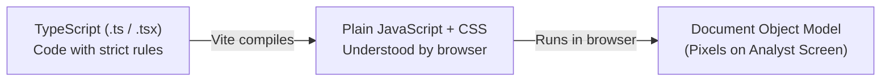
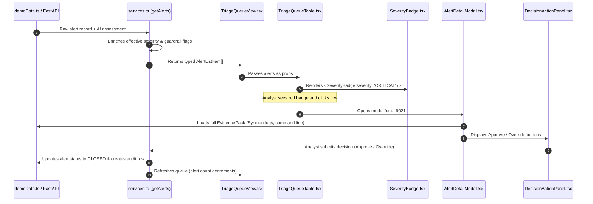
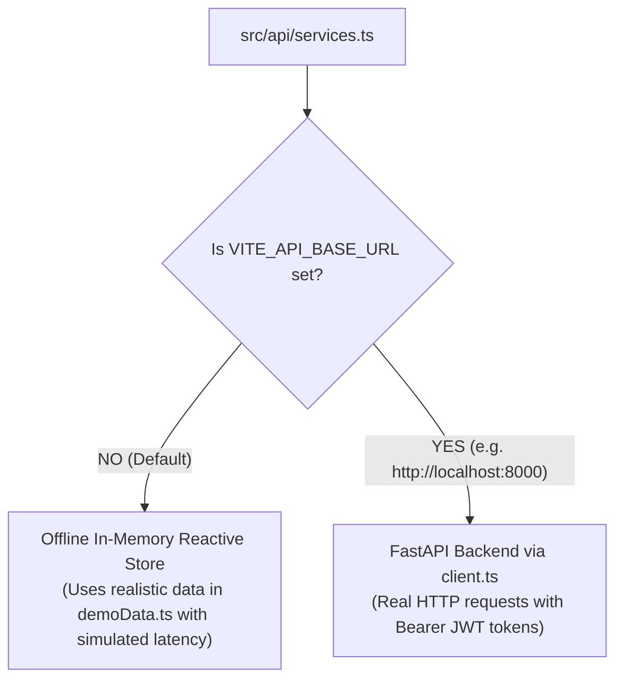

# Sentra-X Frontend Guide for Non-Web Developers (`info.md`)

> **Welcome to the Sentra-X Frontend Guide!**  
> If you don't know JavaScript or TypeScript, and you've wondered: *"Doesn't React just return an HTML file? What is actually happening under the hood?"* — **this document is written specifically for you.**  
>
> You do **not** need any prior web development experience to read this. By the end of this guide, you will understand how the entire Sentra-X frontend works, how each file and folder fits together, how data moves from a database to the pixels on your screen, and how to comfortably navigate and modify the codebase.

---

## Table of Contents

1. [The Big Picture: Does React Return an HTML File?](#1-the-big-picture-does-react-return-an-html-file)
2. [The Tech Stack in Plain English](#2-the-tech-stack-in-plain-english)
3. [The Core React Concepts: How the Magic Actually Works](#3-the-core-react-concepts-how-the-magic-actually-works)
4. [A Guided Tour of the Sentra-X Codebase](#4-a-guided-tour-of-the-sentra-x-codebase)
5. [The Journey of an Alert: From Data to Screen](#5-the-journey-of-an-alert-from-data-to-screen)
6. [Offline Demo Mode vs. Live Backend Mode](#6-offline-demo-mode-vs-live-backend-mode)
7. [The Non-Programmer's Cheat Sheet & Common Tasks](#7-the-non-programmers-cheat-sheet--common-tasks)

---

## 1. The Big Picture: Does React Return an HTML File?

Let's address your exact question first:

> *"I do understand how this works basically react returns a html file right? Or maybe I'm wrong."*

### The Short Answer:
**No, React does not return an HTML file.**  
Instead, React delivers **one single, almost empty HTML file** when you first load the website, and then runs **JavaScript code directly inside your browser** to draw, change, and update the screen in real time without ever loading another page.

This is why this architecture is called a **Single-Page Application (SPA)**.

---

### The Analogy: A Theater Stage vs. Multiple Rooms

To understand the difference, imagine two ways of putting on a play:

#### The Old Way (Traditional Websites - Multi-Page Applications):
* Imagine you have 5 physical rooms in a building: a Lobby, a Security Desk, an Evidence Room, a Manager's Office, and an Archive.
* Every time you want to see something new, you have to pack your bags, walk down the hallway, unlock a new door, and load a brand-new physical room.
* In web terms, every time you click a link (`/queue` or `/analytics`), your browser asks the server for a completely new `.html` file. The screen goes blank for a split second, the whole page reloads, and the browser redraws everything from scratch.

#### The React Way (Single-Page Application - Sentra-X):
* Imagine you are sitting in front of a **single theater stage** with a high-tech robotic crew.
* When you open the site, your browser downloads `index.html`. This file is literally just an empty stage:
  ```html
  <div id="root"></div>
  ```
* That is the entire HTML file! There are no tables, no badges, no buttons written in that HTML file.
* Instead, your browser downloads a bundle of JavaScript code (built by React). That JavaScript code **is the robotic crew**.
* When you click on *"Analytics"*, the crew doesn't take you to a new room. They instantly take away the alert table and assemble the SVG trendline chart right on the same stage.
* **Result:** The URL in your address bar changes to `/analytics`, but the browser **never reloads the page**. Everything happens instantaneously, at 60 frames per second, with zero screen flicker.

---

## 2. The Tech Stack in Plain English

When looking at the files in `c:\projects\SentraX\frontend`, you will see terms like **TypeScript**, **React**, **Tailwind CSS**, and **Vite**. Here is what each one actually does:



### 1. JavaScript (JS)
* **What it is:** The programming language built into every web browser (Chrome, Firefox, Safari, Edge).
* **What it does:** While HTML only defines static text and CSS only defines colors and fonts, JavaScript makes pages **alive**. It listens for mouse clicks, fetches data over the network, calculates statistics, and changes what is displayed on the screen.

### 2. TypeScript (TS) — *Why our files end in `.ts` and `.tsx`*
* **What it is:** A strict, professional version of JavaScript created by Microsoft.
* **The Problem with plain JavaScript:** In plain JavaScript, if you accidentally misspell a word like `alert.severty` (missing the `i`), the program won't warn you while you are writing code. It will simply crash with a scary error (`TypeError: Cannot read properties of undefined`) right in the middle of a high-stress security incident!
* **How TypeScript saves us:** TypeScript forces us to create a strict "dictionary" (called a **type contract**) beforehand in `src/types/sentrax.ts`. If we try to write `alert.severty`, the compiler immediately flags it with a bright red squiggly line: *"Property 'severty' does not exist. Did you mean 'severity'?"*
* **Key Takeaway:** Browsers cannot run TypeScript directly. When we build the project, our tool converts (transpiles) all our clean TypeScript code into standard JavaScript that any browser can run.

### 3. React
* **What it is:** A library developed by Meta (Facebook) that allows developers to build user interfaces using **reusable LEGO blocks called "Components"**.
* Instead of writing 2,000 lines of messy HTML for a complex page, we build small, focused components:
  * A component for a Severity Pill (`<SeverityBadge />`)
  * A component for a Confidence Meter (`<ConfidenceMeter />`)
  * A component for the Alert Table (`<TriageQueueTable />`)
* Then, we assemble them like LEGOs to form full pages.

### 4. JSX / TSX — *Why files end in `.tsx`*
* In traditional programming, HTML (markup) and JavaScript (logic) lived in completely separate files.
* React invented **JSX** (and TypeScript JSX = **TSX**), which allows you to write HTML-like tags **directly inside your TypeScript functions**.
* Example from our codebase:
  ```tsx
  // This is a TypeScript function returning visual UI elements!
  export function WelcomeBadge({ username }: { username: string }) {
    return (
      <div className="bg-zinc-900 border border-zinc-800 p-2 text-zinc-100">
        Active Analyst: {username}
      </div>
    );
  }
  ```

### 5. Tailwind CSS v4
* **What it is:** A utility-first styling engine.
* **The Old Way:** You would create a file called `style.css`, create a class `.my-button`, write 10 rules like `background-color: black; color: white; padding: 8px;`, and then reference it in HTML.
* **The Tailwind Way:** You write short, standardized shorthand names directly inside the HTML tag:
  * `bg-black` $\rightarrow$ Background color pure black (`#000000`)
  * `border border-zinc-800` $\rightarrow$ Add a subtle dark gray border
  * `text-emerald-400` $\rightarrow$ Text color threat-intel green
  * `p-4` $\rightarrow$ Add padding of 16 pixels
  * `flex items-center gap-2` $\rightarrow$ Align elements in a neat horizontal row with 8 pixels between them.
* **Benefit:** You can look at any component in Sentra-X and immediately know exactly how it looks without jumping between CSS files.

### 6. Vite (pronounced *"Veet"*, French for *"fast"*)
* **What it is:** The local development server and build engine.
* When you type `npm run dev`, Vite starts a lightning-fast server at `http://localhost:5173/`.
* When you edit a file and press Save, Vite updates **only that specific component on your screen in less than 50 milliseconds** without refreshing your browser tab!

---

## 3. The Core React Concepts: How the Magic Actually Works

There are only **4 core concepts** you need to understand to master how React works:

```
┌─────────────────────────────────────────────────────────────┐
│ 1. Component  = A function that returns visual UI           │
│ 2. Props      = Arguments passed into that function         │
│ 3. State      = The component's internal memory             │
│ 4. Re-render  = When State changes, React redraws the UI    │
└─────────────────────────────────────────────────────────────┘
```

---

### Concept 1: Components and Props (LEGO Bricks)

Think of a React component like a function in Python or C++:
* A function takes **inputs** and returns a **result**.
* In React, the inputs are called **`props`** (short for properties), and the result is **visual UI elements**.

Look at this real example from our component [`SeverityBadge.tsx`](file:///c:/projects/SentraX/frontend/src/components/badges/SeverityBadge.tsx):

```tsx
// "props" is the data passed in (e.g. severity = "CRITICAL")
export const SeverityBadge: React.FC<{ severity: string }> = ({ severity }) => {
  if (severity === 'CRITICAL') {
    return <span className="bg-red-950 text-red-400 border-red-800">CRITICAL</span>;
  }
  return <span className="bg-zinc-900 text-zinc-300">LOW</span>;
};
```
Whenever we want to display a severity badge in the table, we simply write:
```tsx
<SeverityBadge severity="CRITICAL" />
```
React will execute that function and render a red badge!

---

### Concept 2: State (`useState`) — The Component's Memory

Standard HTML is completely dead and static. If a user clicks a button, plain HTML cannot remember that the button was clicked.

React components, however, have **internal memory** called **State**.
* We define state using a special React function called `useState`.
* Think of state like a variable with a superpower: **whenever the variable changes, React automatically re-draws that component on the screen**.

#### Real Example: Filtering Alerts in Sentra-X
In [`QueueFilterBar.tsx`](file:///c:/projects/SentraX/frontend/src/components/queue/QueueFilterBar.tsx):
```tsx
// 1. Create a memory slot called "searchQuery", starting as empty string ""
// 2. "setSearchQuery" is the function we call to update that memory
const [searchQuery, setSearchQuery] = useState("");

// When user types "Mimikatz" into the input box:
// setSearchQuery("Mimikatz") is called.
// React notices the memory changed, and instantly filters the table rows on screen!
```

---

### Concept 3: Effects (`useEffect`) — Doing Things After Loading

Often, when a page first appears on screen, it needs to do something outside of React:
* Fetch alerts from the backend API.
* Start a timer or SIEM poller.
* Listen for keyboard presses (like pressing `Escape` to close a modal).

React provides **`useEffect`** for this. It tells React: *"Hey, as soon as this component is painted on the user's screen, run this background task."*

#### Real Example: Fetching Alerts When Queue Opens
In [`TriageQueueView.tsx`](file:///c:/projects/SentraX/frontend/src/views/TriageQueueView.tsx):
```tsx
useEffect(() => {
  // When the triage queue loads, call our API service to fetch the alerts
  getAlerts(filters).then((data) => {
    setAlerts(data.items); // Put the fetched alerts into our component's memory!
  });
}, []); // The empty "[]" means: only run this once when the page first opens
```

---

### Concept 4: Context (`AuthContext`) — The Global Loudspeaker

Normally, if a parent component wants to pass data to a child component, it passes it through `props`.  
But what about data that **every single page in the application needs to know**, like:
* *Who is currently logged in?*
* *What is their role (Analyst, TeamLead, Admin)?*
* *What is their JWT authentication token?*

If we had to pass `currentUser` by hand through 20 different intermediate components, it would be a nightmare (called *"prop drilling"*).

Instead, React has **Context**. Think of it as a **central loudspeaker** mounted in the ceiling of the building:
* [`AuthContext.tsx`](file:///c:/projects/SentraX/frontend/src/context/AuthContext.tsx) broadcasts the active user and role to the entire application.
* Any component on any page can simply tune into the loudspeaker:
  ```tsx
  const { user, role, switchDemoRole } = useAuth();
  ```

---

## 4. A Guided Tour of the Sentra-X Codebase

All frontend code lives in the `c:\projects\SentraX\frontend` directory. Here is the architectural map:

```
frontend/
├── index.html                   <-- The ONLY HTML file (the empty theater stage)
├── package.json                 <-- Project manifest (lists libraries: React, Lucide, Tailwind)
├── vite.config.ts               <-- Build and local server configuration
├── src/
│   ├── main.tsx                 <-- The Ignition Key (mounts React into index.html)
│   ├── App.tsx                  <-- Master Route Map (defines which URL opens which page)
│   ├── index.css                <-- Base styles, dark scrollbar rules, Geist fonts
│   │
│   ├── types/                   <-- THE DATA DICTIONARY (Strict Contracts)
│   │   └── sentrax.ts           <-- 100% typed data models matching SRS Section 7.2
│   │
│   ├── context/                 <-- GLOBAL STATE
│   │   └── AuthContext.tsx      <-- Manages login, tokens, and 1-click demo role switching
│   │
│   ├── api/                     <-- THE COMMUNICATION LAYER
│   │   ├── client.ts            <-- HTTP fetch engine (attaches JWT tokens, handles 401/403/422)
│   │   └── services.ts          <-- Unified data functions (getAlerts, submitDecision, runBenchmark)
│   │
│   ├── mock/                    <-- OFFLINE REHEARSAL DATA
│   │   └── demoData.ts          <-- Authentic Wazuh telemetry, Mimikatz, 30 prompt injections
│   │
│   ├── views/                   <-- THE FULL SCREEN PAGES
│   │   ├── LoginView.tsx        <-- Login screen (/login) with 1-click evaluator roles
│   │   ├── TriageQueueView.tsx  <-- Operational triage queue (/queue) with KPI ribbon
│   │   ├── TeamLeadAnalyticsView.tsx <-- Supervisor metrics & SVG charts (/analytics)
│   │   ├── GovernanceView.tsx   <-- Exemplar revocation & Host registry (/governance)
│   │   └── EvaluationRunnerView.tsx  <-- 30-payload benchmark runner (/admin/evaluation)
│   │
│   └── components/              <-- THE REUSABLE LEGO BRICKS
│       ├── layout/              <-- AppShell.tsx (Header + Sidebar), ProtectedRoute.tsx (RBAC guards)
│       ├── badges/              <-- SeverityBadge, VerdictBadge, ConfidenceMeter, GuardrailBadges
│       ├── queue/               <-- TriageQueueTable.tsx, QueueFilterBar.tsx
│       ├── modal/               <-- AlertDetailModal, EvidenceTreePane, DecisionActionPanel
│       ├── analytics/           <-- KpiSummaryGrid, OverrideTrendChart (SVG), SeverityDeltaCard
│       └── evaluation/          <-- ScorecardRibbon, ComparativeMetricsTable, AdversarialSuiteTable
```

---

## 5. The Journey of an Alert: From Data to Screen

To see how all these files work together in real life, let's trace the journey of an alert:

> **Scenario:** Alert `al-9021` (*Mimikatz LSASS Memory Dumping on CORP-DC-01*) is triaged and displayed to an analyst.



### The Step-by-Step Breakdown:

1. **Step 1: The Raw Data Exists**  
   In [`demoData.ts`](file:///c:/projects/SentraX/frontend/src/mock/demoData.ts) (or from PostgreSQL via FastAPI), alert `al-9021` has raw Sysmon telemetry: `procdump64.exe -ma lsass.exe`.
2. **Step 2: Service Layer Fetches and Enriches**  
   [`services.ts`](file:///c:/projects/SentraX/frontend/src/api/services.ts) calls `getAlerts()`. It checks if rule level is $\ge 12$ and whether the host is `CRITICAL`. It calculates the `effective_severity: 'CRITICAL'` and sets `safety_floor_triggered: true`.
3. **Step 3: Triage Queue View Receives the Records**  
   [`TriageQueueView.tsx`](file:///c:/projects/SentraX/frontend/src/views/TriageQueueView.tsx) receives the list. It passes the records into [`TriageQueueTable.tsx`](file:///c:/projects/SentraX/frontend/src/components/queue/TriageQueueTable.tsx).
4. **Step 4: Micro-Badges Draw the Visual Clues**  
   For each row, [`SeverityBadge.tsx`](file:///c:/projects/SentraX/frontend/src/components/badges/SeverityBadge.tsx) draws the red `CRITICAL` pill with a shield icon. [`VerdictBadge.tsx`](file:///c:/projects/SentraX/frontend/src/components/badges/VerdictBadge.tsx) draws `NEEDS REVIEW`.
5. **Step 5: Analyst Clicks the Row**  
   Clicking the row opens [`AlertDetailModal.tsx`](file:///c:/projects/SentraX/frontend/src/components/modal/AlertDetailModal.tsx). The left side ([`AssessmentPane.tsx`](file:///c:/projects/SentraX/frontend/src/components/modal/AssessmentPane.tsx)) shows the AI explanation and citation pills. The right side ([`EvidenceTreePane.tsx`](file:///c:/projects/SentraX/frontend/src/components/modal/EvidenceTreePane.tsx)) shows the exact Sysmon JSON log with glowing highlighted lines.
6. **Step 6: Analyst Takes Action**  
   The sticky bottom bar ([`DecisionActionPanel.tsx`](file:///c:/projects/SentraX/frontend/src/components/modal/DecisionActionPanel.tsx)) lets the analyst approve or override.
   * If overriding, our **Two-Stage Feedback Poisoning Gate** requires them to enter a rationale ($\ge 10$ characters) and verify the comparison in the `Review Override` tab before committing.
7. **Step 7: Instant Screen Refresh**  
   Once submitted, the modal closes, the alert disappears from the `Awaiting Review` tab, and the `Closed Audit Log` counter increments by 1 — all without refreshing the webpage.

---

## 6. Offline Demo Mode vs. Live Backend Mode

One of the most powerful features of the Sentra-X frontend is its **Dual-Mode Architecture**.



### Mode 1: Offline Rehearsal / Academic Demo Mode (Current Active Mode)
* **How it works:** When no backend URL is specified, [`client.ts`](file:///c:/projects/SentraX/frontend/src/api/client.ts) detects that it is in standalone mode.
* [`services.ts`](file:///c:/projects/SentraX/frontend/src/api/services.ts) automatically switches to an internal, in-memory clone of [`demoData.ts`](file:///c:/projects/SentraX/frontend/src/mock/demoData.ts).
* It even includes simulated network delays (e.g., `await simulateLatency(80)`) so loading spinners and transitions feel realistic.
* **Why this is awesome:** You can present, test, and demonstrate the entire frontend on any laptop without needing Docker, PostgreSQL, or Python running in the background!

### Mode 2: Live Production Mode (Connecting to FastAPI)
* When you are ready to connect to your real Python/FastAPI backend, you create a file called `.env` in `frontend/`:
  ```ini
  VITE_API_BASE_URL=http://localhost:8000
  ```
* That is all! You do **not have to edit a single component or view**.
* `isLiveBackendConfigured()` flips to `true`, and all service calls immediately route through real HTTP endpoints (`/api/v1/alerts`, `/api/v1/analytics`, etc.) with authentic JWT headers.

---

## 7. The Non-Programmer's Cheat Sheet & Common Tasks

Here is your quick-reference manual for interacting with the frontend:

### 1. How to Run the Frontend
Open PowerShell in `c:\projects\SentraX\frontend`:
```powershell
npm run dev
```
Then open your browser to **`http://localhost:5173/`**.

---

### 2. How to Test for Errors (Quality Checks)
Before showing your project to professors, clients, or evaluators, run these two commands:

```powershell
# 1. Typecheck and code quality check (checks for syntax errors or bad code)
npm run lint

# 2. Production build check (verifies TypeScript compiles 100% cleanly)
npm run build
```
If both commands finish with **0 errors**, your frontend is 100% healthy!

---

### 3. How to Switch User Roles Instantly
You don't need to manually log out and log in with different passwords to test permissions.
In the top navigation bar of Sentra-X, there is a dedicated **Evaluator Demo Switcher**:
* Click **`[Analyst]`**: You will have access to `/queue`. If you try to open `/analytics` or `/admin/evaluation`, an elegant HTTP 403 Forbidden card will appear.
* Click **`[TeamLead]`**: You gain access to `/analytics` (charts, CSV export) and `/governance` (exemplar revocation).
* Click **`[Admin]`**: You unlock the complete platform, including `/admin/evaluation` (the 30-payload prompt-injection benchmark runner and SIEM configuration).

---

### 4. Where Do I Change...?

| If you want to change: | Open this file: | What to look for: |
| :--- | :--- | :--- |
| **Monitored Assets / Hosts** | [`src/mock/demoData.ts`](file:///c:/projects/SentraX/frontend/src/mock/demoData.ts) | `INITIAL_ASSETS` array (hostnames, IPs, criticality) |
| **Demo Alerts in the Queue** | [`src/mock/demoData.ts`](file:///c:/projects/SentraX/frontend/src/mock/demoData.ts) | `INITIAL_ALERTS` array (rule descriptions, MITRE techniques) |
| **Few-Shot Exemplars** | [`src/mock/demoData.ts`](file:///c:/projects/SentraX/frontend/src/mock/demoData.ts) | `INITIAL_EXEMPLARS` array |
| **Adversarial Payloads** | [`src/mock/demoData.ts`](file:///c:/projects/SentraX/frontend/src/mock/demoData.ts) | `BENCHMARK_30_PAYLOADS` array |
| **App Title / Brand Logo** | [`src/components/layout/AppShell.tsx`](file:///c:/projects/SentraX/frontend/src/components/layout/AppShell.tsx) | Look for `Sentra-X` heading and Shield logo |
| **Abstention Threshold (0.60)** | [`src/mock/demoData.ts`](file:///c:/projects/SentraX/frontend/src/mock/demoData.ts) | `INITIAL_SYSTEM_CONFIG.abstention_threshold` |
| **Top Status Poller Text** | [`src/components/layout/AppShell.tsx`](file:///c:/projects/SentraX/frontend/src/components/layout/AppShell.tsx) | Look for `Polling 30s | Level >= 4` |

---

## 8. Summary of Key Vocabulary

| Term | What It Means in Sentra-X |
| :--- | :--- |
| **SPA (Single-Page App)** | The website lives in one HTML file; React swaps views on the fly with zero page reloads. |
| **Component** | A reusable visual building block (e.g., `SeverityBadge`, `KpiSummaryGrid`). |
| **Props** | Inputs passed into a component (like parameters passed into a function). |
| **State** | The internal memory of a component (like what text is typed in the search bar). |
| **Re-render** | When state changes, React immediately recalculates and redraws that part of the screen. |
| **TypeScript** | JavaScript with strict rules and contracts so you never crash from typos. |
| **Tailwind CSS** | Styling directly in HTML tags (`bg-black text-white p-4`) instead of separate CSS files. |
| **Vite** | The high-speed development server and compiler that powers the project locally. |
| **Dual-Mode** | The ability to run completely offline with mock data or connect live to FastAPI. |

---

> **Congratulations!** You now understand the architectural foundation, the data lifecycle, and the inner mechanics of the Sentra-X frontend. Whenever you want to inspect a screen or make an enhancement, you can refer back to this document as your roadmap.

